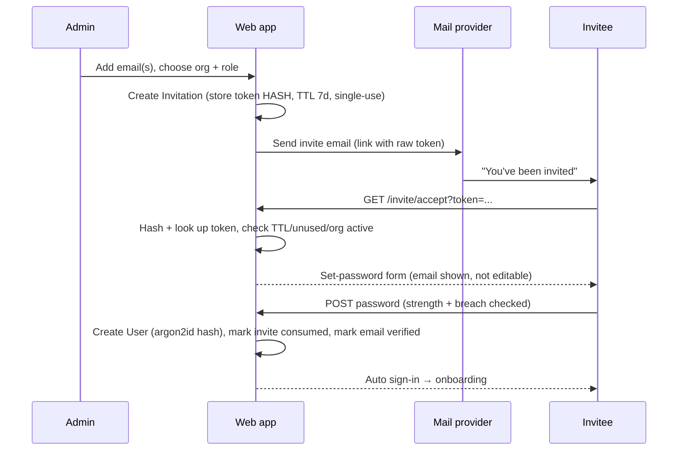
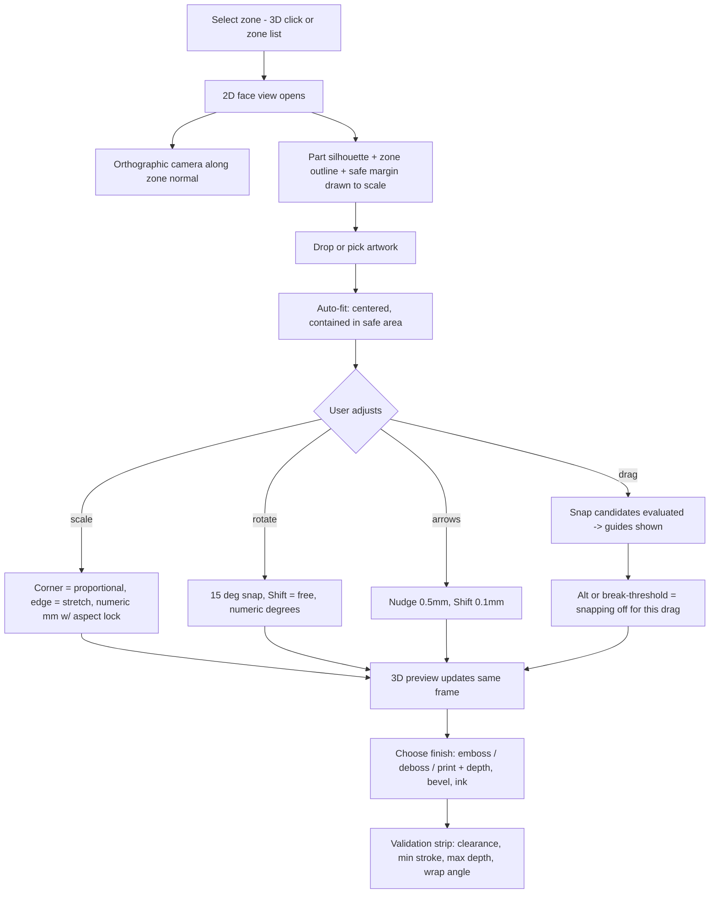
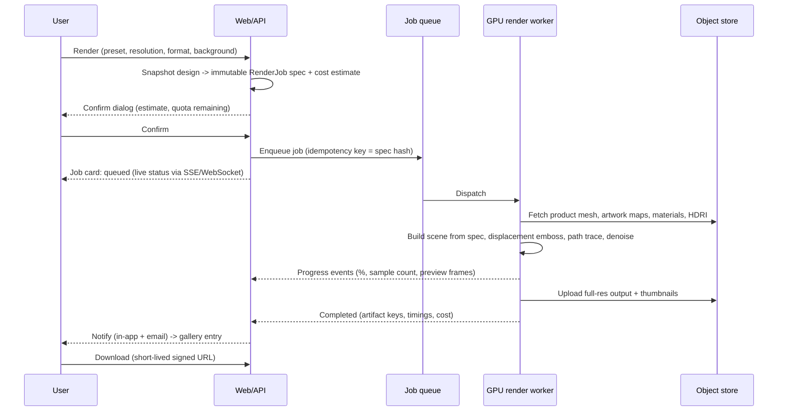
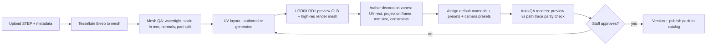

# 02 — Workflows

Each workflow: actor, trigger, preconditions, happy path, edge/failure paths, done-when.
IDs `W-NN` are referenced by tests and tickets.

---

## W-01 — Invitation → verified account → password set

**Actor:** staff or org owner (inviter), invitee. **Features:** F-AUTH-01..04.

**Edge/failure**

- Expired or already-used token → neutral page + "request a new invite" (never reveals whether the email exists).
- Email already has an account → link signs them in / prompts password reset instead of creating a duplicate.
- Bounce/spam: admin sees delivery status and can resend; resend invalidates the previous token.
- Invite revoked before acceptance → token dead immediately.

**Done when:** user is active, email verified, session established, audit entries written.

---

## W-02 — Sign in / reset password

**Actor:** user. **Features:** F-AUTH-04..06.

Happy path: email + password → session cookie → last-opened dashboard.
Failure paths: wrong credentials (generic message, incrementing backoff), locked account after
N failures (time-based unlock + email notice), unverified account (resend verification),
suspended org (explicit "contact your administrator").
Reset: request → always show "if the address exists, we sent a link" → token → new password →
all sessions revoked → sign in.

---

## W-03 — Start a design from the catalog

**Actor:** user. **Features:** F-CAT-01..04, F-PROJ-01.

1. Dashboard → **New design** → catalog grid.
2. Filter (category, neck size, closure type) → product detail drawer (dimensions, decoration
   zone size, allowed finishes, material presets).
3. Choose variant → **Start design** → design created (name defaults to `<Product> — <date>`).
4. Editor opens: LOD0 model streams in, default material preset applied, empty artwork state
   with a call-to-action to upload/choose a logo.

**Edge:** product deprecated mid-session → banner offering the replacement SKU; variant with no
published assets is not selectable.

**Catalog previews (`F-CAT-08`):** Staff open Admin → Packs → Catalog previews, choose Generate or
Regenerate, frame the product in the shared web viewer and press Capture preview. This saves the
canvas without artwork or interface controls. No render worker is needed; failed saves retain the
previous image. Details: [Catalog thumbnail workflow](32-catalog-thumbnails.md).

---

## W-04 — Upload and prepare artwork (SVG)

**Actor:** user. **Features:** F-ART-01..06, F-ART-11/12.

1. Choose **Upload SVG** in `/artwork` or the design editor's upload action. The shared full-width
   workspace checks the 5 MB UTF-8 file, parses static SVG, and resolves supported paint/styles.
   No ready library item or durable draft exists yet.
2. **Select:** start empty; click visible objects or choose objects/groups in the list. Overlap
   and coincident endpoint choices are explicit. Color shortcuts preview candidates. Keep the
   selected paint's visible portions, including holes made by unselected occluders.
3. Optionally enter **Repair paths**. Inclusion is frozen; Inspect is the initial tool.
   Keep intentional strokes open, or preview a straight closure/compatible join/explicit stroke
   width. Inspect before/after paint, highlighted additions/removals and any counter changes,
   then accept the preview and choose **Apply repair**. Pending exit asks whether to
   discard that preview; applied repairs remain undoable and are not yet saved.
4. **Review:** acknowledge a specific open-fill appearance or repaired counter change, or confirm an unspecified physical
   size. Blocking errors cannot be acknowledged away. Ordinary usable open strokes need no closure.
5. **Confirm:** inspect the mark, name, millimetre dimensions and repair summary. Save is disabled
   while the exact recipe's preview is stale or invalid. The server recomputes against the original.
6. Successful save retains private source/recipe and immutable canonical SVG/mask/SDF/contours.
   A design upload returns to its library; choosing the artwork explicitly places it. The demo
   instead adopts the explicitly confirmed mark in the tab and saves nothing.

Unsupported CSS/effects, live text, images, unsafe content, invalid XML/references or excess detail
produce understandable explanations and recovery steps. Re-export outlined opaque vectors where
needed. Gradients and partial opacity are not silently flattened. Cancellation leaves stored
artwork unchanged; reload loses unsaved choices. See [29](29-artwork-preparation.md) for scope,
limits, unhappy scenarios, and the exact meaning of selection.

---

## W-05 — Place artwork in the 2D face view (v1 headline workflow)

**Actor:** user. **Features:** F-PLACE-01..14, F-EDIT-03/04/07. **Product-agnostic:** the view is
generated from the zone definition, so a cap face, a bottle panel, and a box panel behave identically.

### The 2D view

- Orthographic camera locked to the zone's normal; the frustum is the zone extents plus a margin,
  so **screen pixels map to millimetres by a fixed ratio** (`pxPerMm`) shown in the corner.
- The backdrop is the _real part_, flat-shaded, not an abstract rectangle — users recognise the face.
- Overlays: zone boundary, safe margin, center cross-hair, mm rulers, optional grid, custom guides.
- Curved zones are shown **unrolled**; wrap angle is reported and warned about past a threshold.

### Snapping (F-PLACE-05/06)

- Targets, in priority order: zone center X, zone center Y, zone middle lines, custom guides,
  safe-margin edges, zone edges, other placements' centers and edges.
- Threshold is in **screen pixels** (≈6 px), so snapping feels the same at any zoom.
- Only the winning guide(s) draw, and only during the drag.
- **Override is first-class:** hold `Alt` to disable snapping mid-drag, drag past ~1.5× the
  threshold to break a snap, or turn snapping off entirely (persisted per user). Nothing is ever
  positioned somewhere the user didn't choose.

### Sizing (F-PLACE-07)

Proportional corner handles by default; `Shift` frees the aspect ratio; edge handles stretch one
axis. Numeric width/height in mm with an aspect lock toggle. **Fit** (contain in safe area),
**Fill** (cover), and **Reset 100%** (artwork's natural size) are one click each.

**Edge/failure**

- Artwork larger than the zone → auto-fit on drop, with an undoable "kept original size" option.
- Dragged past the boundary → clamped, with a boundary flash rather than a silent snap-back.
- Safe-margin violation → allowed but flagged amber in the validation strip and at render time.
- Zone with no artwork-compatible finish (pack constraint) → finish options disabled with a reason.
- Very high node-count artwork → 2D view falls back to the rasterized preview for interactivity.

**Done when:** the placement (zone id, offset mm, rotation, scale, finish, finish params) is stored
in the design document, the 3D preview matches, and no blocking warnings remain.

## W-06 — Materials and color

**Actor:** user. **Features:** F-MAT-01..05, F-MAT-08.

Select a material slot (cap body, artwork) → pick material family → pick color or
texture → adjust texture scale/rotation where applicable. The artwork is a slot like any other:
what the _mark_ is made of, chosen beside what the part is made of, and a `coating` chosen there is
clear — it glosses the mark rather than painting it. The closure liner is also a slot, but it is
backlogged for removal (`F-MAT-09`) and offers no colour. Presets give one-click colorways.
Changes apply instantly to preview. Constraint: material choices that break a chosen finish
(e.g. metallized surface with blind deboss) surface a warning and a suggested alternative.

---

## W-07 — Scene, camera, framing

**Actor:** user. **Features:** F-SCENE-01..04.

Pick environment (studio presets) → pick camera preset or orbit freely → set background
(sweep / solid / transparent) → optionally save the current camera to the design. The framing
used for the render is exactly what the viewport shows, with an overlay showing the render's
aspect-ratio crop.

---

## W-08 — Photorealistic render (core value path)

**Actor:** user + system. **Features:** F-REND-01..08, F-PLAT-01.

**Edge/failure**

- Quota exceeded / cost cap hit → blocked before enqueue with a clear number and upgrade path.
- Identical spec already rendered → offer the existing result instead of burning GPU time.
- Worker crash/OOM → automatic retry (bounded, different worker); after final failure the job is
  marked failed with a user-readable reason and a staff-only diagnostic trace.
- Timeout → partial/denoised result offered where meaningful, otherwise a failure with refund of quota.
- User cancels → worker receives cancellation, resources freed, quota not charged.
- User closes the tab → job continues; results are waiting on return, email sent.

**Done when:** artifacts are stored, the gallery entry links back to the exact design version, and
the user has downloaded or dismissed it.

---

## W-09 — Iterate: revise logo or colorway

**Actor:** user. **Features:** F-ART-10, F-PROJ-01/03, F-REND-09/12.

Resize, rotate or flip artwork in `/artwork` (W-17), save, then choose its latest version from the
design editor’s artwork library deliberately. Existing designs do not follow artwork edits
automatically. Version-history browsing and an "update to latest" action remain planned.
Alternatively duplicate the design for a colorway. Prior renders remain pinned to the version that produced
them so approvals never silently change. Batch render (P1) produces a matrix of colorways/angles
from a single submission.

---

## W-10 — Share and approve (P1)

Owner generates a view-only link (expiring, optionally password-protected). Reviewer sees the 3D
preview and renders, no edit controls, no access to source assets or downloads unless enabled.
Comments (P2) attach to a render or a 3D pin.

---

## W-11 — Admin: ingest a CAD product into a Product Pack

**Actor:** staff (or, later, any operator of a self-hosted deployment). **Features:** F-ADM-01..03,
F-GEN-01..03. Runs off the user-facing critical path. Output is a **Product Pack**, the only
mechanism for adding products — no code changes, no product-specific branches.

**Edge:** non-manifold or mis-scaled geometry → fails QA with the specific defect; missing UVs →
generated automatically but flagged for review because decoration quality depends on them;
publishing a new revision of an existing product creates a new version, leaving existing designs
pinned to the old one.

---

## W-12 — Admin: materials & environments

Staff creates a material (neutral PBR definition + per-renderer mapping), uploads texture sets or
HDRIs, previews on a reference object, and runs the parity check (preview vs path trace) before
publishing. A material that fails parity beyond tolerance cannot be published.

---

## W-13 — Admin: users, quotas, queue operations

Invite/suspend/remove users, set per-org render quotas and concurrency, inspect the global queue,
retry or cancel jobs, and read worker diagnostics. All actions audited. Built as the queue page
(each job's worker log, retry for failed or cancelled jobs, cancel after a confirmation) and the
System Status page (`/admin/status`: every service, every worker, live work, the server log).

Organization administration (`F-ADM-17`):

1. Open **Admin → Organizations**. Search/filter organizations, or use **Find person** for a
   read-only email lookup across organizations. A result opens the person within their organization.
2. Open an organization. Its name, slug and status remain above **Overview / People / Products /
   Limits / Activity**. The People count in the organization directory opens People directly.
3. Under **People**, search by email, filter role/status and page through all accounts. **Invite
   person** opens an organization-named dialog; an empty organization defaults to inviting its
   first owner. The result reports whether email was actually sent; development links stay
   development-only.
4. Open **Manage** on a person. Role, suspend, restore, delete, resend and revoke retain their
   existing confirmations and server safeguards. Self-edit controls are omitted. Outstanding
   invitation expiry and the sole active-owner warning explain why an action may be unavailable.
5. **Products** reports published packs and current member restrictions. Publishing remains in
   Packs and owners still manage member product restrictions in `/org`.
6. **Limits** saves the existing five quotas. **Activity** pages through recorded changes with
   actor/subject labels and expandable details. Old `/admin/users?q=...` links redirect to the
   organization directory with the email query preserved.

See [31-organization-workspace.md](31-organization-workspace.md) for routes and deferred safeguards.

---

## W-14 — System: failure, backpressure, and recovery

- Queue depth beyond threshold → users see honest ETA + "high demand" banner; new submissions are
  still accepted but flagged.
- GPU capacity unavailable → jobs stay queued (not failed); staff alerted.
- Artwork pipeline outage → uploads rejected with a retry-later message rather than half-processed
  artwork entering the library.
- Any stuck job older than its SLA is surfaced in the staff dashboard automatically. Built: a job
  whose worker has stopped reporting, whose lease lapsed, that is far past its estimate, or that has
  waited over ten minutes (or has no worker to take it) is flagged on the queue and status pages —
  rules in [17-render-service.md](17-render-service.md). The "high demand" banner, honest ETA under
  load and staff alerting are still not built.

---

## W-15 — Author, export, and import a Product Pack

**Actor:** staff/operator. **Features:** F-GEN-01/02/09.

A pack is a self-contained bundle: `manifest.json` (products, variants, zones, material slots,
presets, capability flags) plus assets (preview LODs, render mesh, textures, thumbnails). It is
schema-validated on import and versioned on publish.

1. Ingest one or more parts (W-11) into a working pack.
2. Validate: schema, asset integrity, zone frames inside geometry, UV sanity, QA renders.
3. Export as a versioned bundle (portable across deployments).
4. Import into another environment (staging → prod, or a self-hosted install) with the same
   validation; version conflicts are explicit, never silent overwrites.
5. Conformance: CI imports the two fixture packs (cap + box) and runs the full workflow suite
   against both — a feature that only works on one pack fails the build.

**Edge:** pack references a material or environment that doesn't exist in the target deployment →
import fails with the missing IDs listed; packs may embed their own materials to be self-contained.

---

## W-16 — Owner: administer my own organisation

The organisation's owner, not staff. Everything here is one organisation's own data, and the owner
never sees another's.

1. Owner opens `/org`. A member, or a signed-out stranger, gets the same `notFound()` the staff
   console gives — the area does not admit to existing.
2. **People.** Invite by email with a role of `member` or `owner`; resend or revoke an invitation
   that has not been accepted. Suspend somebody who has left: they cannot sign in, their live
   sessions are revoked in the same transaction, and every design, artwork and render they made
   stays exactly where it is. Reinstate and they are back with all of it.
3. **Product access.** The organisation's catalog, with a per-member switch on each product.
   Withholding one removes it from that member's catalog; it does not touch designs they have
   already made on it, and it does not stop a render already queued.
4. **Overview.** Seats in use, renders against the quota this period, storage. Read-only — quota
   _changes_ stay with staff.
5. **Activity.** The audit trail for this organisation: who invited whom, who suspended whom, who
   changed whose access.

Refusals the owner meets rather than works around:

- Cannot make anyone `staff`, including themselves.
- Cannot suspend or demote the last active owner — an organisation with no owner has nobody who can
  invite one back.
- Cannot delete a member. Suspension covers leaving, and it is reversible; deletion stays with staff.
- Cannot change quotas, publish packs, or see any other organisation.

---

## W-17 — Manage and edit artwork

**Actor:** signed-in user. **Features:** F-ART-01..06, F-ART-10 (immutable versions), F-ART-11, F-NAV-01.

1. Choose **Artwork** in the navigation pill. The shared organisation library opens at `/artwork`.
2. Choose **Upload SVG** and prepare it through W-04. A tile appears only after confirmation
   succeeds. Identical source plus canonical selection/repair/transform recipe can reuse a version.
   There is no upload tile in the gallery.
3. Search by name or sort by newest/name. Desktop shows four tiles across; narrower screens use two.
4. Select a tile. The SVG expands into a 2D viewer/editor and the remaining artwork moves into a
   horizontally scrollable strip below it. The upload button is hidden in this state.
5. Rename, set width/height in millimetres (aspect lock on by default), rotate, flip, or resize with
   corner handles. Corner handles resize proportionally. Zoom, **Fit** and **Pan** change the view
   only. **Undo**/**Redo** apply to unsaved name and shape edits; a corner drag is one undo action.
6. Choose **Save changes**. Shape edits run through the existing sanitise/normalise/validate/derive
   pipeline and become the library’s current immutable version. A rename alone retains the version.
   Every saved design remains pinned to its original version and renders exactly as before.
7. Choose another tile or **Back to artwork**/**Cancel**. Unsaved changes require an explicit
   **Discard changes** decision; in-app navigation and reload/close are also guarded.
8. From the gallery, **Rename** changes a shared label; the tile’s actions menu offers **Delete
   artwork**. Deletion asks first and is refused if a saved design uses any version. The expanded
   editor also offers deletion.

**Failure cases:** dimensions outside 0.01–1000 mm, rotation outside −360°–360°, or an empty name
block saving. A concurrent shape edit yields `409 version_conflict`: reopen before saving. An edit
matching another artwork’s stored content is refused rather than moving versions between artwork
records. Session, storage and network failures are shown without discarding the unsaved edits.

**Edit selection:** source-backed versions reopen W-04 with their saved recipe and composed transforms.
Older uploads show **Reupload original to edit selection**; confirming creates an explicit new
version and preserves old design pins. **Download original SVG** returns a private attachment.

**Not included:** arbitrary node editing, general file replacement, version-history browsing, automatic updates
of saved designs, per-user libraries, folders or tags.

**Done when:** a file uploaded outside a design can be inspected, edited, reopened and chosen from
inside a design, while older pinned versions remain unchanged and another organisation cannot read
or edit it.

---

## W-18 — Archive artwork and inspect a read-only design

**Actor:** an organisation member managing shared artwork. **Features:** F-ART-13.

1. Open Artwork, expand the tile overflow menu, choose **Archive artwork** and review the affected-design count. Confirm to hide the file from Active and the design editor’s picker.
2. Open an affected design. The amber banner names its archived files and provides **View artwork**. Saved placement, materials, finish, orientation and render submission are disabled. Camera controls, cross-sections and temporary inspection lighting remain usable without changing the saved document.
3. Follow **View artwork**, or choose **Archived** in the library. The SVG opens read-only; zoom, pan and retained original downloads remain available.
4. Choose **Restore artwork**. The file returns to Active. Designs become editable when all referenced artwork is restored; returning to an already-open tab refreshes the status.

Archive/restore affects the whole organisation and every artwork version. Files, immutable design
versions and existing renders are retained. Already queued render snapshots can finish. Uploading
identical archived content asks the user to restore the existing file rather than silently restoring
it. A stale tab’s rejected save stops autosave and retains local unsaved work; after explicit restore,
that pending work can save again. No CAD catalogue item is archived.

**Done when:** archived artwork is hidden from new use, saved designs are viewable but uneditable,
viewing controls do not change the stored document, and restoration safely reverses the restriction.

---

## Workflow → feature coverage map

| Workflow   | Primary features                    |
| ---------- | ----------------------------------- |
| W-01, W-02 | F-AUTH-01..07                       |
| W-03       | F-CAT-01..04, F-PROJ-01/02          |
| W-04       | F-ART-01..06/12                     |
| **W-05**   | **F-PLACE-01..14**, F-EDIT-03/04/07 |
| W-06       | F-MAT-01..05/08                     |
| W-07       | F-SCENE-01..04                      |
| W-08       | F-REND-01..08, F-PLAT-01..04        |
| W-09       | F-ART-10, F-PROJ-03, F-REND-09/12   |
| W-10       | F-PROJ-04/05                        |
| W-11..W-13 | F-ADM-01..09, F-GEN-02/03           |
| W-14       | F-PLAT-01/02/07                     |
| W-15       | F-GEN-01/02/09                      |
| W-16       | F-ORG-01..06, F-AUTH-01/02          |
| W-17       | F-ART-01..06/10/11/12, F-NAV-01     |
| W-18       | F-ART-13                          |

## Workspace browsing (F-UI-08)

From Designs, use search/product filtering and grid/list view to find a saved design. Open its overflow menu for Rename, Duplicate or Delete; restore remains under Recently deleted. New design takes you to Catalog to choose the actual product and variant. The editor’s shared navigation returns to Designs, Artwork, Catalog or Renders. Its Render shortcut reveals settings; pressing the settings panel’s Render button submits the job. Admin Organizations can be filtered by name/slug and status.

## Product orientation setup (F-SCENE-08)

Staff CAD uploads keep the existing processing, diagnostic and metadata steps. **Continue setup** then opens Import → Orientation → Decoration zones → Review. Confirm Front/Up (or explicitly keep imported axes), save zones and slot defaults, review diagnostics, then publish. Reopening an unconfirmed draft starts Orientation; a confirmed draft continues zone/material review. The URL preserves the selected stage after reload.

Admin → Packs → Orientation and the zone page's Reorient link start Orientation explicitly. Published/deprecated packs require a new draft; referenced variants cannot be edited underneath existing designs. Each variant is confirmed separately.

The design editor's **Reorient product** uses the same guided page. Zone/material geometry is read-only. Changes stay staged until **Apply to design**; Close discards them. The current camera is preserved unless **Use new Front view** is selected. **Use product default** clears only the design override. **Viewer lighting** offers **Design lighting / Inspection** with a rotation slider shown only when Inspection is selected. Inspection and its rotation are temporary; Design lighting restores the selected **Lighting preset**, which exports continue to use.

Detailed controls, workflows and compatibility: [33-product-orientation.md](33-product-orientation.md).

## Artwork surface targeting and inspection (`F-PREV-08`)

1. In an unused draft product's zone setup, choose **Artwork target part** when artwork belongs to
   a specific part. **Automatic** retains the existing drawable target or selects the sole drawable
   replacement for an empty legacy assembly. Multiple possible replacements require a choice.
2. Save the zone and publish through the existing product setup. To retarget a published/used zone,
   create a new draft version so current designs retain their physical placement.
3. Initial orientation setup and design reorientation use temporary Detail lighting and the same
   Front preview. Changing a candidate orientation does not alter artwork, relief depth or materials.
4. Back in the design editor, choose **Inspection** under **Viewer lighting** for temporary
   surface-relative Detail lighting. **Light rotation** appears only while Inspection is selected.
   **Reset rotation** remains available in either mode; resetting affects only the angle.
   **Design lighting** restores the selected **Lighting preset** and retains the inspection angle
   for switching back. Choose **Detail** in Lighting preset to save it for future image exports.
   Exports always use the saved scene; inspection mode and rotation do not change the output.
5. Older CAD with empty assembly meshes opens using drawable-target resolution and exports through
   scratch-only mesh repair. It does not require changing the original CAD or reuploading the logo.
