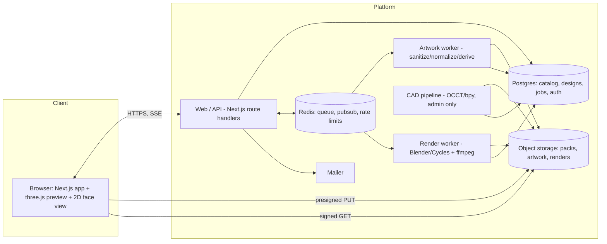

# 10 — System Architecture

## Built artwork preparation boundary

`F-ART-12` runs in the existing web/API process. `packages/svg` safely resolves a bounded static
source, `packages/raster` compiles selected visible vector paint, and `packages/artworks` saves
immutable versions through the existing PostgreSQL and object-store boundary. The browser sends
recipes; the server recomputes them. Private originals are authorized attachments, not inline
preview assets. CSS-tree and Clipper are approved shared libraries; no artwork worker, Redis
service or new queue was added. The diagram and deployment table below remain a target architecture,
not a statement that every pictured service is installed. Current operation is in README and [27](27-deployment.md).

## Context



Everything the browser renders comes from storage via short-lived signed URLs; everything the
renderer consumes comes from the same objects. No third path, no divergent copies.

## Runtime components

| Component | Runtime | Responsibility | Scale unit |
|---|---|---|---|
| `apps/web` | Next.js (Node) | UI, BFF API, auth, SSE fan-out, presigned URL issuance | horizontal, stateless |
| `apps/worker-artwork` | Node + sandboxed child process | SVG sanitize → normalize → rasterize → SDF → height/normal → contours | horizontal, CPU |
| `apps/worker-render` | Node supervisor + Blender CLI (+ ffmpeg) | Build scene from job spec, path trace, denoise, encode, upload | GPU, autoscaled |
| `apps/cad-pipeline` | Python (OCCT, bpy) container, admin-triggered | STEP → mesh/LOD/UV → zone authoring aids → pack assembly | on demand |
| Postgres | managed | System of record; RLS-enforced tenancy | vertical + read replica later |
| Redis | managed | BullMQ queues, pub/sub for progress, rate limits, short-lived caches | managed |
| Object storage | S3-compatible | Packs, artwork + derived maps, render outputs | managed |

## Module boundaries (monorepo)

```
apps/
  web/                Next.js app + API routes           depends: packages/*
  worker-artwork/     artwork job consumer               depends: artwork, design-schema, adapters
  worker-render/      render job consumer + blender/     depends: design-schema, materials, adapters
  cad-pipeline/       Python ingestion tooling           depends: pack schema (via JSON schema export)
packages/
  design-schema/      Zod: DesignDocument, RenderSpec, PackManifest, migrations
  materials/          neutral material defs + three.js and Cycles mappings
  artwork/            sanitize/normalize/derive (pure, no I/O)
  placement/          zone space math, projections, snapping, fitting (pure)
  adapters/           Storage | Queue | Mailer | RenderBackend | Rasterizer interfaces + impls
  db/                 Drizzle schema, migrations, RLS helpers, repositories
  ui/                 design system components
  config/             eslint/tsconfig/tailwind presets
fixtures/
  packs/cap-basic/    fixture Product Pack #1 (cap)
  packs/box-basic/    fixture Product Pack #2 (carton)  <- genericity gate
```

**Dependency rules** (enforced by `eslint-plugin-boundaries` + CI):
1. `packages/*` never imports from `apps/*`.
2. `artwork`, `placement`, `materials`, `design-schema` are **pure** — no network, no fs, no env.
   They are the code that must behave identically in browser and worker.
3. Only `packages/adapters` and `packages/db` touch external systems.
4. `apps/web` never imports Blender/OCCT concerns; `apps/worker-render` never imports React.

## Core data flows

### 1. Artwork upload (W-04)
```
browser → POST /api/artwork/upload-url        (validates quota, mime, size; returns presigned PUT + artworkId)
browser → PUT s3://quarantine/{org}/{artworkId}/source.svg
browser → POST /api/artwork/{id}/process      (enqueue artwork job, idempotency = sha256(bytes))
worker  → sanitize → normalize → validate → rasterize → sdf → height/normal → contours
worker  → PUT s3://artwork/{org}/{artworkId}/{v}/…  → UPDATE artwork_versions SET status='ready'
browser ← SSE /api/artwork/{id}/events        (progress, ready, or rejected + report)
```

### 2. Placement + preview (W-05) — entirely client-side after assets load
```
GET /api/designs/{id}            → DesignDocument (JSON)
GET signed URLs                  → pack LOD0 GLB, zone metadata, artwork maps, HDRI, material defs
placement package (pure TS)      → zone-space transform, snapping, fit
preview engine (three.js)        → composite zone texture → shade → render on demand
mutations                        → command stack → debounced PATCH /api/designs/{id}
```

### 3. Render (W-08)
```
POST /api/renders                → snapshot DesignDocument → RenderSpec (immutable) → hash
                                   quota + cost check → BullMQ enqueue (jobId = hash unless forced)
worker-render                    → resolve assets by digest → build .blend via generated Python
                                   → path trace (progress events → Redis → SSE) → denoise
                                   → (v2) encode video → upload outputs → mark complete
GET /api/renders/{id}/download   → short-lived signed GET
```

## Adapter interfaces (the self-host seams, `F-GEN-04/05`)

```ts
interface ObjectStorage {
  presignPut(key: string, opts: {contentType: string; maxBytes: number; ttlSec: number}): Promise<string>;
  presignGet(key: string, ttlSec: number): Promise<string>;
  put(key: string, body: Uint8Array | ReadableStream, meta?: Meta): Promise<{etag: string}>;
  get(key: string): Promise<ReadableStream>;
  head(key: string): Promise<{size: number; etag: string} | null>;
  delete(keys: string[]): Promise<void>;
}

interface JobQueue {
  enqueue<T>(queue: string, name: string, data: T, opts: EnqueueOpts): Promise<JobHandle>;
  cancel(queue: string, jobId: string): Promise<void>;
  onProgress(queue: string, cb: (e: ProgressEvent) => void): Unsubscribe;
}

interface RenderBackend {                    // Cycles today; Omniverse/V-Ray/etc. later
  readonly id: string;                       // "cycles"
  readonly version: string;                  // pinned, recorded on every output
  capabilities(): RenderCaps;                // displacement, transmission, video, max resolution
  run(spec: RenderSpec, ctx: RenderContext): AsyncIterable<RenderEvent>;  // progress → artifacts
}

interface Rasterizer { rasterize(svg: string, opts: {widthPx: number; heightPx: number}): Promise<RGBA8>; }
interface Mailer { send(msg: {to: string; template: TemplateId; vars: Json}): Promise<void>; }
interface AuthProvider { /* password (default) | oidc (v3) */ }
```

Each adapter ships a **conformance test suite**; a swapped implementation must pass it. That is
what makes "run it on your own infra" a supported claim rather than an aspiration.

## Provenance tuple (determinism)

Every render output records:

```
{ designVersionId, designSchemaVersion, packId + packVersion, artworkPipelineVersion,
  materialLibraryVersion, rendererId + rendererVersion, seed, samples, hostGpuModel }
```

Re-render (`F-REND-12`) replays that tuple. Any component version bump is a *new* output, never a
silent change to an approved image.

## Deployment topology

| Environment | Web | Workers | Data |
|---|---|---|---|
| dev | `pnpm dev` | local containers; render backend = CPU Blender, 32 samples | Docker Postgres/Redis/MinIO |
| staging | 1–2 instances | 1 small GPU worker | managed, seeded, prod-like |
| prod | autoscaled | artwork: CPU pool; render: autoscaled GPU (serverless) | managed + PITR |
| self-host (v3) | single container | single worker (CPU or 1 GPU) | Docker Compose: Postgres, Redis, MinIO |

## Failure domains

- **Web down** → no editing; queued renders continue and are visible on recovery.
- **Artwork worker down** → uploads queue; the library shows "processing", nothing half-ingested.
- **Render workers down/at capacity** → jobs stay `queued` (never auto-failed); banner + staff alert.
- **Storage unavailable** → uploads and renders fail fast with retry; existing designs still open
  from cache where possible.
- **Redis loss** → queue rebuilt from `render_jobs` rows (Postgres is the record; Redis is transport).

## Why this shape

- One deployable for product surface (Next.js) keeps auth, RLS, and the API in one place.
- Heavy, hostile, or slow work (SVG parsing, path tracing, CAD) runs out-of-process with tight
  sandboxes — the security model in [05](05-security.md) depends on that separation.
- Pure packages shared by browser and worker are the mechanism behind WYSIWYG; they are the most
  test-covered code in the repo.

## Standalone artwork editing (`F-ART-11`)

`/artwork` is part of the authenticated web application, using the existing PostgreSQL tenancy and
object store. The web API loads the stored sanitised SVG and edits through `packages/artworks`;
`packages/raster` owns the pure whole-artwork transform shared with the SVG viewer. Existing ingest
regenerates the mask, SDF and contours. Shape edits append immutable versions, leaving design and
render references intact. No new worker, service, dependency or alternate storage path is introduced.
