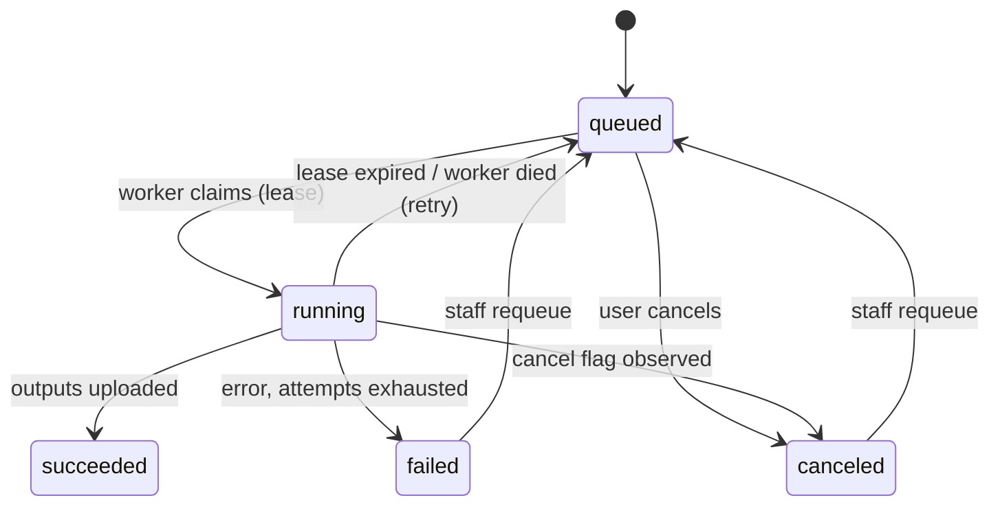

# 17 — Render Service (Blender/Cycles worker)

`apps/worker-render`: a Node supervisor that turns a validated `RenderSpec` into images (v1) or a
turntable video (v2). Blender is invoked as a child process with a **generated** Python script; no
user-supplied code, no user-supplied `.blend`, ever.

Imported parts retain their material ownership when the renderer replaces Blender materials.
Blender resets polygon material indices when a material collection is cleared, so the renderer
saves the assignments first and restores them after replacement. Named slots also survive mesh
joining that changes their order; a polygon whose slot name matches nothing falls back to the decorated slot.
The Blender integration suite verifies distinct colors on two joined parts.

---

## Job lifecycle



Leases: a claim sets `status='running'`, `started_at`, `worker_id` and a lease expiry. A sweeper
requeues jobs whose lease lapsed (worker crash, spot reclaim) up to `MAX_ATTEMPTS = 3`, then marks
`failed` with a user-readable class.

Staff retry only what failed or was cancelled. A succeeded job is refused (`409 not_retryable`):
running it again renders the same pixels and charges the organisation for them. Cancelling from the
queue page asks first.

### Workers and stuck jobs (`F-ADM-07`, `F-ADM-15`)

The lease proves a worker is alive only while it holds a job, and only once the lease runs out — a
worker killed mid-render looked busy for two minutes. So every worker (render and CAD) also:

- **registers** in `workers` when it starts (kind, host, pid, engine and engine version);
- **reports in every 10 s** whether or not it holds a job, naming the job it holds;
- **marks itself stopped** on a clean shutdown (`SIGINT`/`SIGTERM`).

Liveness is derived when read, against the database clock, never stored: **alive** within 30 s of
the last report, **stale** up to 5 minutes, **gone** after that, **stopped** after a clean
shutdown. Rows unseen for 7 days are removed when another worker starts.

A job is flagged **stuck** (`jobConcerns` in `@pr/job-queue`, pure and unit-tested) when:

| Concern         | Rule                                                            |
| --------------- | --------------------------------------------------------------- |
| `worker_silent` | running, and its worker is not alive (or not registered)        |
| `lease_lapsed`  | running, and its lease has expired — the next sweep requeues it |
| `overdue`       | running longer than 4× its estimate, and at least 15 minutes    |
| `no_worker`     | queued, and no worker of its kind is alive                      |
| `waiting_long`  | queued for more than 10 minutes                                 |

The queue page and the System Status page show these; nothing acts on them automatically — the
sweeper remains the only thing that requeues.

### A job's own log

Each job keeps its worker's log lines in `log` (JSONB on `render_jobs` and `cad_jobs`): claimed,
each stage as it starts, warnings, errors, and the outcome — info and above, never the per-tick
progress lines. The worker buffers them and writes every 3 s and once at the end, keeping the newest
200; fields the line already implies (`jobId`, `workerId`, `orgId`, `requestId`) are dropped and long
values truncated. Staff read it from the job's **Log** button on the queue and CAD pages
(`GET /api/admin/queue/{id}`, `GET /api/admin/cad/{id}`). A worker that dies loses at most its last
few seconds of lines; its warnings and errors are also in the service event log.

## Supervisor loop

```ts
async function runJob(claim: JobClaim) {
  const spec = RenderSpec.parse(claim.spec); // trust nothing, even from our own API
  const scratch = await mkdtemp(); // wiped in `finally`
  const hb = heartbeat(claim.jobId, { everyMs: 10_000 }); // extends the lease

  try {
    await report('assets');
    const assets = await fetchAssets(spec, scratch); // digest-verified downloads

    await report('bake');
    const baked = await bakeArtworkMaps(spec, assets, scratch); // TS profile → height/ink PNGs

    await report('build');
    const scriptPath = writeSceneScript(spec, assets, baked, scratch); // generated Python

    await report('trace');
    const result = await runBlender(scriptPath, scratch, {
      onProgress: (p) => report('trace', p),
      cancelSignal: cancelWatcher(claim.jobId), // Redis flag, checked every 2 s
      timeoutSec: spec.limits.maxWallClockSec,
    });

    if (hasVideo(spec)) {
      await report('encode');
      await encodeVideo(result.frames, spec, scratch);
    }

    await report('upload');
    const outputs = await uploadOutputs(scratch, spec, claim); // scoped, short-lived credentials
    await complete(claim.jobId, {
      outputs,
      provenance: provenanceOf(spec, result),
      gpuSeconds: result.gpuSeconds,
    });
  } catch (e) {
    await failOrRetry(claim, classify(e)); // oom | timeout | asset_missing | blender_crash | canceled
  } finally {
    hb.stop();
    await rm(scratch, { recursive: true });
  }
}
```

## Artwork baking (the parity hand-off)

```ts
// Uses the SAME packages/artwork profile function as the GLSL preview shader.
async function bakeArtworkMaps(spec, assets, scratch) {
  const out = [];
  for (const pl of spec.document.placements) {
    const { sdf, mmPerPx, range } = await readSdf(assets.artwork[pl.artwork.versionId]);

    if (pl.finish.kind === 'print') {
      out.push({
        placementId: pl.id,
        ink: writePng(inkFromMask(sdf, mmPerPx, pl.finish), scratch),
      });
      continue;
    }

    const h = new Uint16Array(sdf.length);
    const params = {
      depthMm: pl.finish.depthMm,
      bevelDeg: pl.finish.bevelDeg,
      edgeRadiusMm: pl.finish.edgeRadiusMm,
      kind: pl.finish.kind,
    };
    for (let i = 0; i < sdf.length; i++) {
      const mm = heightMm(decode(sdf[i], range), params); // ← shared implementation
      h[i] = encode16(mm, HEIGHT_ENCODE_RANGE_MM); // fixed range ⇒ Blender decodes exactly
    }
    out.push({
      placementId: pl.id,
      height: writePng16(h, scratch),
      heightRangeMm: HEIGHT_ENCODE_RANGE_MM,
    });
  }
  return out;
}
```

## Generated Blender script (pseudocode)

Run as `blender --background --factory-startup --disable-autoexec --python scene.py -- <spec.json>`.

```python
# scene.py — generated per job; reads only the spec + local files it names
import bpy, json, math, sys
spec = json.load(open(sys.argv[sys.argv.index('--') + 1]))
MM = 0.001                                        # Blender works in metres; the pack is authored in mm

def build():
    reset_scene()                                  # factory startup + explicit purge
    obj = import_mesh(spec['resolved']['meshKey'])  # GLB/blend, digest already verified
    obj.scale = (MM, MM, MM); bpy.ops.object.transform_apply(scale=True)

    for slot in spec['document']['materials']:
        assign_material(obj, slot, spec['document']['materials'][slot], material_defs(spec))

    for placement in spec['document']['placements']:
        apply_placement(obj, placement, zone_def(spec, placement['zoneKey']))

    setup_world(spec['resolved']['environment'], spec['document']['scene'])
    setup_view_transform(spec)                     # AgX + exposure — must match the preview
    setup_cycles(spec['quality'], spec['seed'], spec['limits'])
    return obj

# ---- zone coordinates as a NODE GROUP: analytic, per-shading-point, mirrors 15 §2 ----
def zone_coord_nodes(nt, zone):
    pos = nt.new('ShaderNodeNewGeometry').outputs['Position']
    if zone['type'] == 'planar':
        local = vector_transform(nt, pos, zone['frame'])                       # world → zone basis
        return separate_xy(nt, local)                                          # (x, y) in mm
    if zone['type'] == 'cylindrical':
        p      = vector_transform(nt, pos, axis_frame(zone['frame']))
        theta  = math_node(nt, 'ARCTAN2', p.y, p.x)                            # around the axis
        x      = math_node(nt, 'MULTIPLY', math_node(nt, 'SUBTRACT', theta, radians(zone['frame']['centerAngleDeg'])),
                           zone['frame']['radiusMm'])                          # arc length
        y      = math_node(nt, 'SUBTRACT', p.z, zone['frame']['centerHeightMm'])
        return (x, y)
    if zone['type'] in ('uv_rect', 'flat_panel'):
        uv = nt.new('ShaderNodeUVMap'); uv.uv_map = zone.get('uvSet', 'decor')
        return uv_rect_to_zone_mm(nt, uv.outputs['UV'], zone)
    if zone['type'] == 'conformal':
        return conformal_projection_nodes(nt, pos, zone['frame'])

def apply_placement(obj, placement, zone):
    mat = obj.material_slots[zone['materialSlot']].material
    nt  = mat.node_tree
    zx, zy = zone_coord_nodes(nt, zone)

    # Zone mm → artwork-local UV, using the placement transform (15 §4), inverted
    uv = mapping_node(nt, (zx, zy),
                      translate=neg(placement['transform']['offsetMm']),
                      rotate=-radians(placement['transform']['rotationDeg']),
                      scale=inv(placement['transform']['sizeMm']))

    if placement['finish']['kind'] == 'print':
        ink = image_texture(nt, baked_path(placement, 'ink'), uv, colorspace='sRGB', extension='CLIP')
        # Base colour, roughness and metallic together, from the material the design named — not
        # from the finish kind. A *filled relief* takes the same helper, off its decoded depth
        # rather than the ink map, so a foil emboss and a foil print are one material (F-MAT-05).
        shade_ink(nt, bsdf, placement['ink'], ink)                             # @pr/materials resolves the numbers
    else:
        height = image_texture(nt, baked_path(placement, 'height'), uv,
                               colorspace='Non-Color', extension='CLIP')
        mm     = map_range(nt, height, 0, 1, *placement['heightRangeMm'])      # decode to millimetres
        disp   = nt.new('ShaderNodeDisplacement')
        disp.inputs['Midlevel'].default_value = 0
        disp.inputs['Scale'].default_value    = MM                              # mm → m
        link(nt, mm, disp.inputs['Height']); link(nt, disp, mat.node_tree.nodes['Material Output'].inputs['Displacement'])
        mat.cycles.displacement_method = 'BOTH'                                 # true geometry + bump detail
        enable_adaptive_subdivision(obj, dicing_rate=spec['quality']['displacement']['dicingRate'])
        if placement['finish'].get('inkMaterialKey'):
            tint_artwork_area(nt, mat, placement)                               # emboss + ink (e.g. foil)

def setup_cycles(q, seed, limits):
    s = bpy.context.scene
    s.render.engine = 'CYCLES'
    s.cycles.device = 'GPU'
    s.cycles.samples = q['samples']
    s.cycles.use_adaptive_sampling = True
    s.cycles.adaptive_threshold = q['adaptiveThreshold']
    s.cycles.max_bounces = q['maxBounces']
    s.cycles.seed = seed                                   # determinism
    s.cycles.use_denoising = q['denoiser'] != 'none'
    s.cycles.denoiser = 'OPTIX' if q['denoiser'] == 'optix' else 'OPENIMAGEDENOISE'
    s.cycles.time_limit = limits['maxWallClockSec']         # hard stop inside Blender too
    s.render.film_transparent = any(o.get('alpha') for o in spec['outputs'])

def setup_view_transform(spec):
    bpy.context.scene.view_settings.view_transform = 'AgX'  # paired with three.js AgXToneMapping
    bpy.context.scene.view_settings.exposure = spec['document']['scene']['exposureEv']

def render_images(obj):
    for i, out in enumerate(spec['outputs']):
        if out['kind'] == 'video': continue
        place_camera(out['camera'], obj)                    # focal/sensor → identical FOV to preview
        bpy.context.scene.render.resolution_x = out['widthPx']
        bpy.context.scene.render.resolution_y = out['heightPx']
        # draft pre-pass streams a preview frame within seconds, then the full-quality render
        render_to(f'{scratch}/preview-{i}.png', scale=25, samples=max(16, spec['quality']['samples'] // 16))
        render_to(f'{scratch}/output-{i}.png', scale=100, samples=spec['quality']['samples'])

def render_turntable(obj, out):                              # v2 — ONE orbit path for every product
    r = bounding_sphere(obj).radius * out['orbit']['radiusScale']
    frames = out['fps'] * out['durationSec']
    for f in range(frames):
        az = radians(out['orbit']['startAzimuthDeg'] + 360.0 * f / frames)
        place_camera_orbit(r, az, radians(out['orbit']['elevationDeg']), target=bounding_sphere(obj).center)
        render_to(f'{scratch}/frames/{f:05d}.png', samples=spec['quality']['samples'])
```

Because the camera path is derived from the bounding sphere, the turntable works on a cap, a
bottle, and a carton with no per-product configuration (`F-REND-10`).

## Progress, preview frames, cancellation

```ts
// Blender stdout is parsed, not trusted for control flow.
const SAMPLE_RE = /Sample (\d+)\/(\d+)/;
child.stdout.on('line', (l) => {
  const m = SAMPLE_RE.exec(l);
  if (m) onProgress({ samplesDone: +m[1], samplesTotal: +m[2], progress: +m[1] / +m[2] });
});

// Preview frames (v1): the 25% draft pre-pass is uploaded as soon as it lands, giving users a real
// image within seconds. True progressive streaming is a later enhancement, not a v1 promise.

// Cancellation: cooperative, then forceful.
cancelWatcher.on('cancel', async () => {
  child.kill('SIGTERM'); // Blender flushes and exits
  setTimeout(() => child.kill('SIGKILL'), 10_000);
});
```

## Quality presets

| Preset   | Samples | Adaptive threshold | Bounces | Denoiser | Displacement             | Typical 2K time |
| -------- | ------- | ------------------ | ------- | -------- | ------------------------ | --------------- |
| Draft    | 64      | 0.05               | 4       | OptiX    | bump only                | 15–30 s         |
| Standard | 512     | 0.01               | 8       | OptiX    | displacement, dicing 1.0 | 1–3 min         |
| Final    | 1500    | 0.005              | 12      | OIDN     | displacement, dicing 0.5 | 3–8 min         |

Presets are data (`packages/materials/presets.ts`), tuned per renderer version and re-validated by
the parity suite when Blender is upgraded.

## Cost accounting

```
gpuSeconds  = wallClock × gpuCount
costCents   = ceil(gpuSeconds × pricePerGpuSecondCents × OVERHEAD_FACTOR)
estimate    = f(preset, megapixels, placements, displacement, videoFrames)   // fitted on real jobs, updated weekly
```

Estimates are shown before submit and enforced against `org_quotas`; actuals are written to
`usage_events` and reconciled nightly against the provider's billing export.

## Backend adapters (`F-GEN-04`)

```ts
class CyclesLocal implements RenderBackend {} // dev: CPU/GPU container on the same host
class CyclesServerless implements RenderBackend {} // prod v1: Modal/RunPod/fal — scale to zero
class CyclesK8sGpu implements RenderBackend {} // prod later: own GPU pool, cheaper at volume
```

All three run the _same_ container image and the _same_ generated script; only scheduling,
credentials, and log transport differ. Swapping backends must not change a pixel — verified by
running the parity suite against each.

## Worker hardening (summary; full model in [05](05-security.md))

- Non-root, read-only root FS, writable scratch only, no inbound network, egress limited to the
  object store and the internal API.
- `--factory-startup --disable-autoexec`; add-ons off; no `.blend` from users; scripts generated
  from a schema-validated spec with no string interpolation into paths or shell.
- Per-job caps: wall clock, VRAM, RAM, output bytes, frame count. Breach ⇒ kill + quarantine.
- Storage credentials scoped to `renders/{orgId}/{jobId}/*` and the read-only asset prefixes the
  spec names, expiring with the lease.

## Orientation in immutable image exports

The web resolver captures the effective frame and explicit source-space camera in the immutable RenderSpec. The Cycles scene builder uses shared `placeLights` with that frame and orients the world gradient along Up. It does not transform meshes, zone frames, baked artwork or custom cameras. Inspection lighting is excluded from job inputs.

The orientation-aware shared turntable helper is prepared, but **video export remains backlogged (`F-REND-10`)**; this feature does not add a working video pipeline. Deploy/restart web and render workers from the same revision before using the new frame or Detail key. A mixed fleet running old worker code cannot reproduce these new inputs. Existing queued specs without orientation keep the old path.

The full regression run also exposed a pre-existing carton export defect: Blender names the sole
`TEXCOORD_0` layer `UVMap`, while pack zones request `decor`. The importer now translates that single
known layer name and reverses Blender’s import-time V conversion before constructing decoration
nodes, restoring the pack’s source UV coordinates. It does not guess among multiple UV sets. Existing stored output images are not rewritten.

The preview’s camera far plane now includes its studio shell after lens/orbit changes, avoiding
clipped black background discs found during carton parity verification. This changes no saved
camera coordinates or studio profile.

## Existing CAD transport and artwork targets (`F-PREV-08`)

Before Blender import, the local backend inspects drawable GLB primitives, their material names
and their scene-space bounds. Legacy zero-count primitives/accessors and zero-byte views are removed
only in a job scratch copy; surviving binary buffers, material indices and node transforms are
preserved. Source storage keys/digests and source files are never rewritten. A file with no drawable
geometry fails rather than receiving invented geometry. Repair is restricted to static CAD files.

For repaired historical files, Blender's dimensional import check uses measured drawable bounds.
Shared camera/light framing still uses the captured historical bounds; compatibility does not
silently reframe a saved design. Healthy files retain the ordinary declared-bounds check.

Each baked placement carries the shared resolved decoration material slot. Original polygon
material names are captured before assignment replacement, preserving the part-to-material mapping
when the leading assembly slot has no geometry. Explicit zone targets travel inside the immutable
RenderSpec; malformed or ambiguous targets produce a failed render with a useful reason.

## Current viewer lighting (F-REND-15)

Render captures the viewer's active studio, studio rotation and optional source-space lighting
orientation when clicked, including Inspection mode and its rotation. Pending saves must succeed
before submission. Render no longer switches the viewer back to Design lighting.

The validated snapshot becomes the immutable job's `resolved.environment` and participates in the
spec hash. Its optional `orientation` moves lights and studio-gradient Up independently of product
presentation and camera. Both preview and Cycles use shared `placeLights` and curated presets.
Omitted snapshots fall back to saved lighting; older jobs keep their presentation-frame fallback.
See [the plan and verification](35-render-current-lighting.md).
