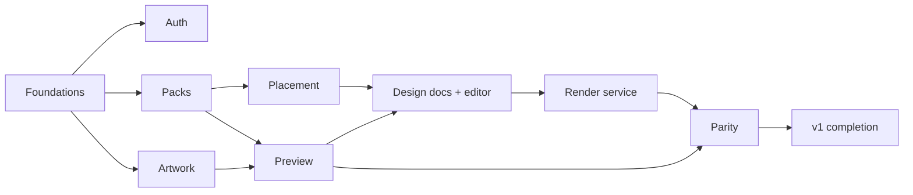

# 21 — Build Order

Sequencing, dependencies, and sizes. Assumption: 1–2 full-stack engineers with occasional 3D/CAD
help. Sizes: **S** ≤ 1 day, **M** 2–3 days, **L** 4–8 days, **XL** split before starting.

Critical path in one line:
**parity spike → pack loader → artwork pipeline → placement package → face view → preview → render worker → the rest.**

---

## M0 — Parity spike (target: 1 week, throwaway code allowed)

| # | Ticket | Size | Deps | Done when |
|---|---|---|---|---|
| M0-1 | STEP → GLB by hand for one cap (OCCT/Blender), authored decor UVs | M | — | Mesh loads in three.js, scale correct in mm |
| M0-2 | SVG → mask → SDF script (Node) | M | — | SDF PNG with mm metadata for a test logo |
| M0-3 | `heightMm()` profile in TS + GLSL, sweep comparison | S | M0-2 | Max deviation ≤ 1e-3 mm across parameter sweep |
| M0-4 | three.js scene: debossed logo via SDF shading | M | M0-1..3 | Depth/bevel sliders respond instantly |
| M0-5 | Blender script: same design, displacement emboss, AgX | M | M0-1..3 | Path-traced PNG of the same view |
| M0-6 | SSIM comparison + report | S | M0-4/5 | A number, a heatmap, and a go/no-go decision |

**Gate:** stakeholders agree the pair matches, and we have a defensible SSIM budget. If not, revisit
the preview approach (parallax, or in-browser path tracing tier) before M1.

## M1 — Walking skeleton (target: 4–6 weeks)

### Epic A — Foundations
| # | Ticket | Size | Deps |
|---|---|---|---|
| A1 | Monorepo scaffold (pnpm/turbo), configs, boundaries lint | M | — |
| A2 | CI pipeline: static, unit, integration containers | M | A1 |
| A3 | Postgres + Drizzle schema (identity, catalog, artwork, designs, jobs) + migrations | L | A1 |
| A4 | RLS policies + `withTenant` + cross-tenant tests | M | A3 |
| A5 | Storage/Queue/Mailer adapters + conformance suites (MinIO, Redis, log-mailer) | M | A1 |
| A6 | Observability: structured logs, OTel spans, Sentry, request IDs | M | A1 |

### Epic B — Auth (W-01, W-02)
| # | Ticket | Size | Deps |
|---|---|---|---|
| B1 | Invitation create/resend/revoke + email templates | M | A3, A5 |
| B2 | Accept invite → verify → set password → session | M | B1 |
| B3 | Login, logout, session middleware, lockout, rate limits | M | B2 |
| B4 | Password reset + session revocation | S | B3 |
| B5 | Security headers, CSRF, authz policy module + route audit test | M | B3 |

### Epic C — Product Packs (F-GEN-01/02)
| # | Ticket | Size | Deps |
|---|---|---|---|
| C1 | `PackManifest` schema + validator + JSON-Schema export | M | A1 |
| C2 | Pack import (CLI + admin route): validate → assets → catalog rows | L | C1, A3, A5 |
| C3 | `cap-basic` fixture pack from the M0 asset (one product, two zones) | M | C2 |
| C4 | `box-basic` fixture pack (flat panels, print-only) | M | C2 |
| C5 | Catalog API + signed asset delivery | M | C2, B5 |

### Epic D — Artwork pipeline (W-04)
| # | Ticket | Size | Deps |
|---|---|---|---|
| D1 | Upload URL issuance, quarantine bucket, quota checks | M | A5, B5 |
| D2 | Sanitizer + hardened XML parse + allow-lists | L | A1 |
| D3 | Normalizer (transforms, strokes→fills, text policy, SVGO lock) | L | D2 |
| D4 | Validation + `ArtworkReport` codes | M | D3 |
| D5 | Rasterize (resvg) + SDF + contours + thumbnail; sandboxed worker | L | D3, A5 |
| D6 | Artwork API + SSE + library UI | M | D5 |
| D7 | SVG fuzz corpus in CI | M | D2 |

### Epic E — Placement + face view (W-05, the headline)
| # | Ticket | Size | Deps |
|---|---|---|---|
| E1 | `packages/placement`: zone mappers (planar, cylindrical, uv_rect), unit tests | L | C1 |
| E2 | Transform math, corners/AABB, clamping, fit/fill/natural | M | E1 |
| E3 | Snapping engine + sticky release + override + guides model | L | E2 |
| E4 | Face view flattening pass (three.js RT) | L | E1, F1 |
| E5 | Overlay canvas: transform box, handles, rulers, guides, mm readouts | L | E3, E4 |
| E6 | Keyboard model: nudge, rotate, scale, align actions | M | E5 |
| E7 | `validatePlacement` shared client/server + validation strip | M | E2, C1 |

### Epic F — Preview engine
| # | Ticket | Size | Deps |
|---|---|---|---|
| F1 | R3F scene, GLB/LOD loading, environment, camera presets from bbox | L | C5 |
| F2 | Zone texture composition (MRT, profile in GLSL) | L | D5, E1 |
| F3 | Material patching: normal perturbation, ink mixing, material library mapping | L | F2 |
| F4 | Render-on-demand, adaptive quality, disposal discipline | M | F1 |
| F5 | Preview screenshot + design thumbnail upload | S | F1 |

### Epic G — Design documents
| # | Ticket | Size | Deps |
|---|---|---|---|
| G1 | `DesignDocument` schema + migration chain + validators | M | C1 |
| G2 | Design CRUD API with `If-Match`, autosave, versioning | M | G1, A4 |
| G3 | Command stack (undo/redo, coalescing) + editor stores | L | G1 |
| G4 | Editor shell: top bar, rails, panels, Place/Look modes | L | G3, E5, F1 |

### Epic H — Render service (W-08)
| # | Ticket | Size | Deps |
|---|---|---|---|
| H1 | `RenderSpec` build from design snapshot + spec hash + estimate | M | G1 |
| H2 | Queue, job rows, lease/heartbeat/retry/sweeper | M | A5, A3 |
| H3 | Worker supervisor: claim, assets, bake, invoke, upload, complete | L | H2, D5 |
| H4 | Blender scene builder (materials, zone nodes, displacement, camera, AgX) | XL→split | H3, C3 |
| H5 | Progress + draft pre-pass preview frames → Redis → SSE | M | H3 |
| H6 | Cancel, quota enforcement, cost accounting | M | H2 |
| H7 | Render dialog, job tray, gallery, download with signed URLs | L | H5, B5 |
| H8 | `RenderBackend` adapters: local + serverless | M | H3 |

### Epic I — Parity & staging
| # | Ticket | Size | Deps |
|---|---|---|---|
| I1 | Parity harness + SSIM budgets + CI artifacts | L | F3, H4 |
| I2 | Two-pack conformance matrix in Playwright | M | C4, E7 |
| I3 | Staging environment + IaC + seeded data + smoke tests | L | A2, H8 |

**M1 exit:** W-01 → W-08 completed unaided on staging by an internal user, with `box-basic`
importing and rendering through the same code path.

## M2 — v1 completion (target: 4–6 weeks)

| Theme | Tickets |
|---|---|
| Catalog & onboarding | Catalog UI with pack-declared facets, product detail, quick 3D preview, dashboard, empty states |
| Materials | Material library UI, colorways, texture scale/rotation, ink/foil materials, per-pack presets |
| Placement polish | Custom guides, grid, alignment actions, clearance readouts, wrap warnings, multi-select prep |
| Rendering | Quality presets tuning, resolutions, alpha/backgrounds, notifications (in-app + email), re-render |
| Admin (`W-11`–`W-13`) | ~~CAD ingestion~~ *(scoped, not built — see [23](23-cad-ingestion.md))*, zone authoring with test-pattern QA, pack publish/deprecate, users/quotas, queue ops, audit log |
| Platform | Rate limits everywhere, retention jobs, backup + restore drill, status banner, error taxonomy |
| Quality | ~~Accessibility pass (WCAG 2.2 AA)~~ *(permanent backlog — see `F-PLAT-08`)*, performance budgets in CI (`pnpm bundle:budget`), load test (`load/`, `saturation.integration.test.ts`), pen-test prep ([22-pentest-brief.md](22-pentest-brief.md)) |

**M2 exit:** every P0 feature accepted; security checklist green; parity + conformance green. The
accessibility pass is out of this gate while `F-PLAT-08` sits in the backlog — worth saying plainly,
because a gate that quietly drops a criterion is how a project ends up believing it passed one.

## M3 — Pilot hardening (2–4 weeks)

Instrument SVG acceptance rate, render success rate, queue wait, cost/render, and time-to-first-render.
Fix the top three usability findings in placement. Tune quality presets against real customer artwork.
No new features unless a pilot blocks on them.

## M4 — v2 (see [07](07-roadmap.md))

Bottle + box packs, turntable video, PDF spec sheet, multi-placement/multi-zone, artwork version-history browsing/update-to-latest,
batch renders, share links, team management, 2FA, raster/PDF ingestion, analytics.

## M5 — v3 / platform

Lifestyle backplates + custom HDRIs, assemblies, approvals, AR, STEP export, self-host distribution,
public API, white-label, embeddable widget.

---

## Dependency graph (condensed)

## The first ten tickets, in order

1. A1 monorepo scaffold → 2. A2 CI → 3. A3 schema → 4. A4 RLS + cross-tenant tests →
5. C1 pack manifest schema → 6. D2 sanitizer → 7. D5 derive pipeline → 8. E1 zone mappers →
9. F1 R3F scene + pack loading → 10. E4/E5 face view + overlay.

Auth (Epic B) runs in parallel from day one; it is well-understood and unblocks staging access, but
it is not on the critical path for proving the product works.

## Estimation notes

- H4 (Blender scene builder) is the single largest risk item after M0 — split it into materials,
  zone coordinate nodes, displacement, and camera/output as four tickets with their own tests.
- E3/E5 (snapping + overlay) will take longer than they look: the feel is the feature. Budget time
  for a tuning pass with real users in M3.
- Anything touching both renderers (profile math, materials, tone mapping) gets a parity test in the
  same PR — retrofitting them later is how WYSIWYG rots.

## F-ART-12 follow-up delivery

The approved selection/preparation spec is [29](29-artwork-preparation.md). It extends the existing
SVG/raster/artwork packages, gallery/editor and upload workflow. Delivery includes pinned CSS and
Boolean tooling, a shared preparation/explicit repair UI, additive source metadata, source-bound
server recomputation, immutable version adoption, synthetic conformance fixtures and local
verification. It adds no worker, container, durable draft service or GitHub CI trigger. General
node editing, arbitrary compound splitting, tracing, multicolor mapping and entire hidden-object
extraction remain outside this delivery.
