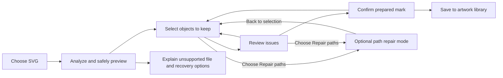
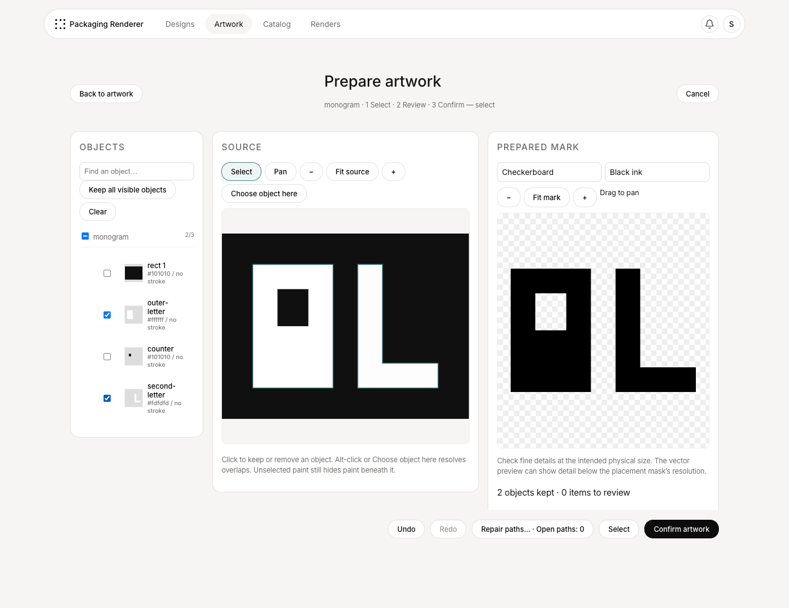
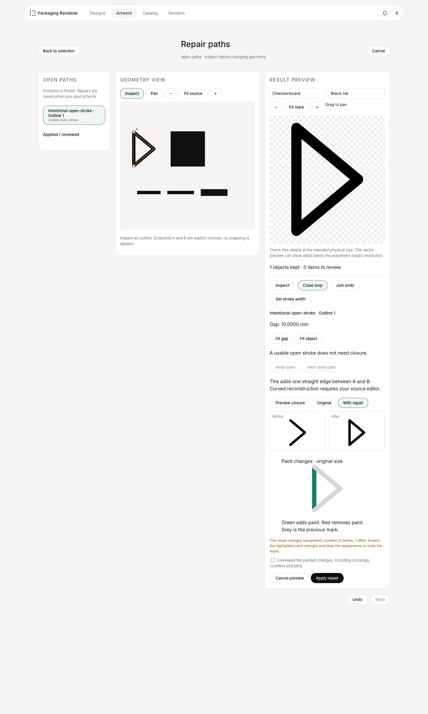

# 29 — Select and prepare SVG artwork

**Status: implemented; review pending.** The carton preview/render acceptance check remains
unresolved, so this delivery is not yet declared ready to merge.
**Feature:** `F-ART-12`. Extends upload `W-04`, the artwork library
`F-ART-06`, versioning `F-ART-10`, and the existing editor `F-ART-11`.

**Review direction:** selection never repairs or explicitly closes source paths. Path repair is
an optional, separately entered mode. This feature is isolated from the completed Artwork
gallery/editor delivery. The user approved the CSS-tree and Clipper dependencies for this implementation.

## 1. Outcome and scope

After uploading an SVG, the user clicks the objects they want to use as their logo, optionally
enters **Repair paths**, and confirms a preview of the resulting mark. Source colors help identify
objects; they do not decide what is logo, background, raised material, or a hole.

The prepared result is a single-color mark with a transparent background. Its material and
emboss/deboss/print finish remain placement choices. The original appearance remains available
as a reference; the prepared mark is what the library tile and product placement display.

Recommended first delivery:

- Faithful safe source preview for a documented subset of static vector SVG.
- Click-to-keep objects, group selection, object list, and optional color selection shortcuts.
- Keep the selected objects' **visible portions**, preserving holes and occlusion.
- A separate **Repair paths** mode: inspect open subpaths, retain valid open strokes, preview
  explicit straight closure, or join two compatible open strokes. Import, selection, preview,
  and save never add a source-path closure on the user's behalf.
- Undo/redo, result preview, validation, and immutable save with a recoverable source and recipe.

Outside this delivery: full node/Bézier editing, guessing missing curves, automatic tracing of
images, arbitrary splitting of a compound path, and multicolor/spot-finish mapping (`F-ART-07`).
These require different tools or product decisions; a selection screen cannot reliably supply them.
Existing accessibility backlog `F-PLAT-08` is not expanded by this proposal.

## 2. What the investigation established

SVGs can define contrasting foreground and background paint in embedded stylesheets. Before this feature, the
sanitizer removes those stylesheets, leaving paths to fall back to black during normalization.
The mask rasterizer separately combines filled geometry without respecting paint colors or
layer compositing. Preserving CSS alone therefore cannot deliver this workflow. A full-canvas
background shape can consequently turn a processed mark into a solid rectangle.

Before this feature, the app stored normalized source and derived assets, not original upload bytes. Old records
cannot recover discarded styles without the original files. Implementation fixtures and retained
documents must use synthetic, generic artwork; do not retain customer artwork, names, upload
identifiers, or customer-specific geometry as a reference fixture.

Relevant implementation areas: `packages/svg/src/{sanitize,normalize,validate,path}.ts`,
`packages/raster/src/{artwork,stroke,edit}.ts`, `packages/artworks/src/service.ts`, and the web
artwork upload/editor components. Some pipeline documentation describes intended behavior:
`docs/14-artwork-pipeline.md` names resvg, but the built rasterizer is custom TypeScript.

## 3. Upload journey and screen layout



Entry from **Upload SVG** in Artwork or the saved design's upload action opens the same preparation
workspace. From a design, successful save returns the artwork to that design's library; it does
not silently place it. No ready library item exists until confirmation succeeds.

Use the existing navigation, Inter typography, linen background, white panels, hairline borders,
16 px corners, and existing button/confirmation patterns. Keep **Artwork** active in the standalone Artwork flow; an upload from a design returns to that design and keeps its existing navigation context. This is a
full-width workspace, not a small upload modal. Hide the global upload action while preparing.

Conceptual desktop wireframe; labels and dimensions are illustrative:

```text
 Designs   Artwork   Catalog   Renders

 Back to artwork       Prepare artwork                         Cancel
 sample-logo.svg       1 Select  ·  2 Review  ·  3 Confirm

 ┌───────────────────┬───────────────────────────┬──────────────────────┐
 │ Objects           │ Source                    │ Prepared mark        │
 │ Find an object…   │                           │                      │
 │                   │ Original styled logo      │ Selected visible     │
 │ [ ] Group 1       │ with hover outlines       │ portions on a        │
 │   [✓] Path 12     │ and selection outlines    │ checkerboard         │
 │   [✓] Path 13     │                           │                      │
 │   [ ] Path 14     │ [Select] [Pan]  −  Fit  +  │ Light / Dark backing │
 │                   ├───────────────────────────┴──────────────────────┤
 │ Select similar…   │ Click an object to keep it. Click again to undo. │
 │ All / Clear       │ 12 objects kept · 2 items to review              │
 └───────────────────┴──────────────────────────────────────────────────┘

 Undo  Redo       Repair paths…             Review 2 items →
```

At narrower widths, use Source/Prepared tabs for one large canvas and a collapsible object panel.
Keep the current step and action visible. Fit/zoom and pan change only the view. Pointer selection
and panning are separate modes; dragging must not accidentally toggle objects. The filmstrip of
other artwork is absent during preparation to keep the task focused on one upload.

### Step 1 — Select

- Start with nothing kept. Show the intact source and an empty result with “Click the parts you
  want to use.” **Keep all visible objects** is available for already-clean files.
- Hover highlights the exact pick target without changing its color or the document. Click
  toggles it; repeated clicks add/remove objects without a modifier key. Empty canvas clicks do
  not clear the selection. Thin geometry gets a screen-space pick tolerance, never wider output.
- The object list has a thumbnail, source label when available, fallback such as “Path 12,” and
  a checkbox. Do not invent semantic names such as “tree” or “letter B.” Clicking a row focuses
  and frames it; its checkbox controls inclusion. Selection updates both canvases and the list.
- Clicking a group checkbox keeps/removes its descendants; mixed selection is shown. Canvas
  picking defaults to the visible leaf object, so a whole Illustrator group is not selected by
  accident. **Select containing group** is an explicit shortcut.
- When targets overlap or are too small, **Choose object here** lists candidates in stacking
  order with highlighted previews. Hidden objects are listed separately and excluded by default.
- **Select similar color** adds visible objects with matching computed paint. Exact match is
  the default; “Include similar shades” previews the expanded set before applying it. This is
  a shortcut to object selection, not a destructive color replacement or a pixel tracing tool.
- For an object with both fill and stroke, a small inspector offers **Both / Fill / Stroke**.
  A compound path remains one object; its holes stay associated with it. Selecting one letter
  inside a compound word is not promised in this delivery.
- Next is disabled for an empty visible result, even if selected object IDs exist. Undo/redo
  covers selection, color shortcut application, repairs, and dimension changes.
- Selection has no endpoint handles or close/join actions. A passive **Open paths: 3** badge can
  open an explanation and the **Repair paths** action. Never enter repair mode automatically.
  That action remains available for a selected repairable path even when its result has no area;
  otherwise the user could be trapped behind the disabled Next button.

### Step 2 — Review

The side panel becomes an issue list scoped to the selection and everything affecting its
appearance. Clicking an issue frames the affected part and explains it. **Repair paths** is an
explicit action that opens the separate mode in section 5, focused on that path. Merely opening
an issue, selecting another object, or proceeding to confirmation cannot apply a repair.
Ordinary valid open strokes do not interrupt the flow. If there are no review items, Step 1
continues directly to confirmation.

Users can acknowledge an explained appearance, return to selection to exclude an object, or
enter repair mode. A prior acknowledgement expires when an edit changes the issue. Blocking
issues cannot be acknowledged away. The final review need not have zero open paths.

### Step 3 — Confirm

Show the prepared monochrome mark at useful scale beside the styled reference, selected bounds
in millimetres, chosen dimensions, and a short list of repairs and accepted differences. The
preview background and preview ink color are viewing aids, not saved artwork objects.

Primary action: **Save artwork**. From an existing source-backed artwork: **Save new version**.
The result preview must be current for the exact recipe being saved; while recalculating show
“Updating preview…” and disable save. A changed selection invalidates an older server response.

After success, show the prepared mark in the gallery and existing viewer/editor. **Edit selection**
reopens preparation for source-backed versions. Existing size/rotation/flip edits must compose
with the selection recipe; reselecting must not unexpectedly reset those transforms. Show final
dimensions again whenever changing the selection changes its natural bounds.

## 4. The meaning of “keep”

**Default: keep the visible portion of selected paint, as it appears in the source.** An
unselected foreground object still hides selected paint behind it during extraction. It does
not become an inked object in the result. All colors use the same rule.

For example, a large white badge behind a black badge contributes only its visible white border.
Selecting it must not produce a solid white badge when the black object is omitted. Similarly,
black counters placed over white letters must remain holes even when those black objects are
not selected. Deleting unselected XML nodes first would give the wrong result.

The preparation engine must compile that visible result into a self-contained mark before
dropping unused objects. It may bake dependencies into geometry or retain necessary non-painted
clipping definitions. “Only retained artwork” means no unrelated visible objects, not removing
every definition referenced by a selected object. The private source remains separate.

An optional **Use entire object, including hidden parts** mode is deferred: it is useful for
recovering obscured geometry, but changes the meaning of selection. In this delivery, a fully
hidden selected object produces no mark; explain this and offer deselection or source editing.

The canonical prepared SVG and its mask must agree about holes and visible bounds. A monochrome
gallery preview cannot be produced merely by repainting all original paths black. Neither
pixel tracing nor curve simplification with an unspecified tolerance is an acceptable silent fix.

### Generic selection walkthrough

Use a synthetic monogram made from contrasting shapes and a separate decorative line. The user
keeps the monogram objects, omits its background, and sees counters preserved in the result.
The decorative line is an intentional open stroke and can be retained without closure. If a
second synthetic outline has a missing straight edge, the user explicitly enters **Repair paths**
to inspect and close it. These examples exercise different concerns without retaining customer art.

## 5. Separate Repair paths mode

### 5.1 Entry, boundaries, and exit

The selection toolbar and relevant review cards expose **Repair paths…**. Entering it is always
a deliberate user action. The header changes to **Repair paths**, with **Back to selection** in
a stable position. Object inclusion is frozen while repairing: clicks now inspect contours or
endpoints and cannot add/remove artwork. To include another object, return to selection first.

Start in **Inspect**, with no pending geometry change. The object list becomes an open-path list
for retained objects. Keep the previous selection view's zoom/pan so returning feels continuous;
repair mode can frame the active gap independently. Unselected objects remain reference context
and still affect occlusion, but cannot be edited in this mode.

**Apply repair** updates the in-page preparation draft after a preview. **Back to selection**
keeps those applied repairs and returns to selection; it never commits an artwork version.
Show “Repairs are saved when you save artwork.” If a preview is pending on exit, offer
**Discard preview and return / Stay in repair mode**. Applied changes remain undoable.

### 5.2 Repair workspace

```text
 Back to selection          Repair paths             Undo  Redo
 Inspect  ·  Close loop  ·  Join ends

 ┌──────────────────────┬─────────────────────────────────────────────┐
 │ Open paths           │ Path 7 · Outline 1                         │
 │                      │                                             │
 │ Path 7    Review     │ Geometry view             Result preview    │
 │ Path 9    Usable     │   A ○ · · · · ○ B         proposed change   │
 │ Path 12   Usable     │     proposed edge                            │
 │                      │ Gap: 0.18 mm    Fit gap / Fit object        │
 │ Reviewed / Applied   │ Original / With repair                      │
 ├──────────────────────┴─────────────────────────────────────────────┤
 │ This adds a straight edge between the two ends of this outline.   │
 │ Keep open     Preview closure     Cancel preview    Apply repair  │
 └───────────────────────────────────────────────────────────────────┘
```

The wireframe combines states for illustration: **Preview closure** appears in Inspect/Close
loop; **Cancel preview / Apply repair** appear only after a current valid preview is available.

- List each open subpath, including separate contours inside a compound object. Selecting one
  frames it without splitting the source object or separating its holes.
- Distinguish **Usable open stroke**, **Review fill boundary**, **Blocked**, and **Repair applied**.
  “Open” alone is not a failure and never displays a red error badge.
- In geometry view, draw the actual open contour, label its ends A and B, and draw a proposed
  edge as a dashed overlay. Use solid versus dashed lines and labels, with existing semantic
  colors only as additional cues. Never alter the document merely to make the overlay visible.
- **Fit gap** enlarges small gaps; **Fit object** restores context. The adjacent Result view
  shows the full painted consequence, including any newly filled region or changed stroke join.
- Show gap distance in confirmed artwork millimetres. If units are unresolved, label drawing
  units and ask for a physical size before making millimetre-based claims.
- **Keep open** records a reviewed choice, changes no coordinates/closure flags, and lets the
  user move to **Next open path**. It cannot dismiss an unrelated blocking error.
- After applying a repair, keep the same object framed and show its new status. **Next open
  path** is explicit; do not jump to another contour while the user is inspecting the result.
- A repair entry can be undone. Reverting an older repair with dependent joins requires undoing
  those later operations too; explain the dependency rather than leaving a broken recipe.

### 5.3 Open paths versus SVG filling

An open path is not automatically malformed. SVG can fill an open subpath using an implicit
straight boundary while leaving its stroke open. Preserving that original appearance is different
from modifying the source path to close it. Explicit closure can add a visible stroked edge and
change caps/joins. Assess every subpath, not just whether the whole path ends with `Z`.
See [SVG filling](https://www.w3.org/TR/SVG2/painting.html#FillProperties) and
[path closure](https://www.w3.org/TR/SVG2/paths.html#PathDataClosePathCommand).

In selection, label this case “Open outline with a filled interior”; show a read-only explanation
that the SVG already fills across the gap. Offer **Keep appearance** or **Repair paths**. Do not
say that the app will automatically close it. An intentional open stroke remains open even if
its painted width is converted to a filled outline in the derived mark.

Only an explicit applied repair adds a closure/join to the editable source recipe. Generated
coverage contours may be closed boundaries around painted regions; they do not count as repairs
and must never replace the original editable path's open/closed state. Import and save must not
add unrequested closing edges or change fill/stroke behavior to achieve a closed-path count.

### 5.4 Available operations

| Condition                                      | Action in Repair paths                                                   | Result and guardrail                                                                                                                |
| ---------------------------------------------- | ------------------------------------------------------------------------ | ----------------------------------------------------------------------------------------------------------------------------------- |
| Open stroke with a usable width                | **Keep open**                                                            | Retain its painted area, including cap/join appearance. No closure required.                                                        |
| Open filled subpath                            | **Keep appearance** or **Preview closure**                               | Explain the SVG's existing implicit fill edge. Explicit closure is applied only after preview.                                      |
| One subpath with separated endpoints           | **Close loop** → **Preview closure**                                     | Connect its last endpoint to its first with one straight edge. Show the entire changed region.                                      |
| Endpoints coincide but path is formally open   | **Close loop**                                                           | Preview changed cap/join behavior, even when the gap reads zero.                                                                    |
| Two compatible open strokes                    | **Join ends** → choose endpoint A → choose endpoint B → **Preview join** | Add the chosen straight connection and show the remaining open ends. Joining does not imply a closed loop.                          |
| Selected geometry has no fill or usable stroke | **Set stroke width**                                                     | Explicitly assign a positive width with preview, or return to selection and exclude it. This changes paint, not the path's closure. |

For **Close loop**, there is only one start/end pair for the focused subpath; previewing it does
not choose a neighboring outline. For **Join ends**, highlight compatible targets after the user
chooses the first endpoint. If multiple endpoints occupy the same screen position, present a
small candidate list with path labels and previews. Never pick the closest endpoint silently.

**Join ends** is limited to two retained, unbranched stroke-only subpaths with compatible paint,
width, transforms after coordinate resolution, and appearance dependencies. Incompatible targets
remain explainable through the inspector. Filled-path stitching, joins across complex clips,
and multi-way junctions require source editing in the first delivery.

No automatic snapping, endpoint movement, smoothing, or **Close all** action is included. A
straight closure across a large gap is possible when valid, but its actual new edge and resulting
area must be clearly previewed. Large gap size alone is not proof of an error. If the user needs
a curved connection, explain that the tool cannot infer it and recommend source editing.

### 5.5 Validation, progress, and recovery

Changing the operation, endpoints, or dimensions invalidates the pending preview and disables
**Apply repair** until recomputation finishes. Apply must bind to the current recipe revision.
Preview timeout/failure leaves the draft unchanged and offers retry or cancel.

A new self-intersection, lost hole, degenerate region, or unsupported dependency must be reported
before applying. Block unreliable/invalid output; when a valid fill-rule result changes topology,
highlight the changed areas and require explicit acceptance of that preview. Closing one contour
does not waive checks on sibling contours.

Undo returns the path to its prior geometry and status. An applied repair retained in the draft
remains visible in its history when its object is later deselected; it has no output effect while
that object is excluded. Reselecting shows the repair badge and restores that same edited object.
Starting a different file discards its recipe after confirmation; IDs and repair choices are
never carried onto an unrelated source. The original stored source is never overwritten.

The completion message describes the outcome, for example “2 repairs applied; 3 usable open
strokes kept.” Do not use “all paths closed” as the success criterion or force users through
repair mode before saving otherwise valid artwork.

## 6. Supported input boundary

First delivery targets static vector shapes with solid fill/stroke, groups, transforms,
compound paths with their fill rules, safely resolved embedded styles, and internal reusable
objects. Correct cap/join/dash behavior is part of support for any accepted stroke.

Opaque overlap and correct letter holes are mandatory. Clip paths require correct dependency
resolution and visible-geometry compilation before acceptance. They must not be dropped.
Per-instance selection of an internal reuse must not mutate its sibling instances.

Gradients, partial opacity, soft masks, filters, patterns, and blend modes are outside the initial
selection-to-solid-mark guarantee. Some can be displayed by a suitable renderer, but that alone
does not establish how they should become one solid region. If they affect selected output,
block save and offer exclusion, an explicitly supported simplification if later approved, or
re-export as outlined opaque vectors. Do not imply that a luminance threshold is an exact vector
conversion. Fully transparent artwork also cannot be made visible simply by selecting it.

Live text requires outlining in the source application; embedded raster images need tracing in
another application. Neither a source preview nor an SVG file extension proves editable vector
geometry exists. If the entire source cannot be previewed faithfully within the supported subset,
show a specific analysis failure rather than a misleading “original” preview.

## 7. Unhappy scenarios and recovery

“Blocked” below means no prepared version can be saved until corrected or the affected content
is explicitly excluded and the remaining result is revalidated.

| Scenario                                                               | Response / recovery                                                                                                       | Remaining limitation                                                                            |
| ---------------------------------------------------------------------- | ------------------------------------------------------------------------------------------------------------------------- | ----------------------------------------------------------------------------------------------- |
| Styles are removed or computed incorrectly                             | Block faithful preparation; identify unsupported rule and request a self-contained export.                                | CSS handling needs an actual supported cascade, not class-name regex substitutions.             |
| White logo and white background share paint                            | Color shortcut highlights both; user removes the unwanted object in the list.                                             | Intent cannot be inferred from color.                                                           |
| Tiny or overlapping objects cannot be clicked                          | Zoom, pick tolerance, object list, and candidate chooser.                                                                 | Very dense files may still be tedious.                                                          |
| One compound path contains the entire word/logo                        | Highlight the entire selectable object; preserve its holes.                                                               | Selecting one component inside it requires source editing in this delivery.                     |
| A visible feature is empty space between objects                       | Explain that there is no source object to click.                                                                          | Extracting negative space needs a bounded region/boolean tool; no reliable general v1 solution. |
| Hidden white geometry emerges after deselection                        | Preserve source occlusion during extraction; show the compiled result.                                                    | Direct deletion of other XML nodes is insufficient.                                             |
| A letter hole is a separate overlaid shape                             | Preserve the overlay's subtraction effect without painting it in the mark.                                                | If dependency compilation fails, block; never fill the hole silently.                           |
| User wants hidden geometry restored                                    | Explain visible-only selection.                                                                                           | Entire-object extraction is deferred.                                                           |
| Stroke is open intentionally                                           | Keep its painted area and caps; no required closure.                                                                      | The application cannot infer that it was intended to enclose an area.                           |
| Open fill spans an unintended region                                   | Explain its existing implicit fill boundary; keep appearance, exclude it, or explicitly enter Repair paths.               | Selection never inserts a closing edge. Correct missing curvature requires external editing.    |
| Several endpoints are equally plausible partners                       | User picks the exact pair; preview every connection.                                                                      | No automatic nearest-neighbor stitching.                                                        |
| Closure creates a crossing or changes a hole                           | Revalidate, show the changed region, undo/exclude if wrong.                                                               | Ambiguous or unsupported topology blocks save.                                                  |
| Two ends have different widths/styles or clip contexts                 | Explain incompatible join; offer separate retention or source repair.                                                     | No automatic style harmonization.                                                               |
| Fills self-intersect or overlap with opposite winding                  | Honor each object's fill rule and compositing.                                                                            | Do not union all contours with one global winding rule. Invalid results block save.             |
| Reused symbols share one definition                                    | List/pick instances separately; retain the selected instance's resolved appearance.                                       | Circular or excessive references are blocked.                                                   |
| Gradient, soft mask, partial opacity, or blend effect defines the edge | Explain why a solid region is ambiguous; exclude or re-export.                                                            | No universal conversion rule; future threshold controls need separate design.                   |
| Missing font, linked image, external stylesheet                        | Never fetch arbitrary dependencies; provide an outlining/embedding export hint where supported.                           | Font substitution and raster tracing are not offered.                                           |
| Clip or mask disappears during processing                              | Treat the dependency as required, with a blocking diagnostic if unsupported.                                              | Accepting an altered silhouette is not a warning-only path.                                     |
| All retained objects are hidden/empty/outside the usable canvas        | Show empty result and the reason; focus offending objects.                                                                | No save until visible area exists.                                                              |
| Transparent padding or off-canvas objects distort size                 | Show source canvas separately from kept bounds; fit the prepared canvas to kept bounds without rescaling geometry.        | Missing/ambiguous physical units require the user to confirm a size.                            |
| Valid detail is too thin for the selected product                      | Show preview-resolution warning during preparation; zone-specific warnings at placement.                                  | Upload alone cannot certify manufacturability.                                                  |
| File is oversized, malformed, recursive, or excessively complex        | Stop analysis with a precise limit/fix hint; let the user choose a simpler file.                                          | No truncated “successful” logo.                                                                 |
| Suspicious active content or unsafe URLs                               | Apply the fixed security policy; block if safe faithful interpretation is unavailable.                                    | User controls never re-enable active content.                                                   |
| User cancels, navigates away, or refreshes                             | Existing discard confirmation; keep committed artwork intact; explain that unsaved preparation must restart after reload. | Cross-session draft recovery is deferred.                                                       |
| Preview requests arrive out of order                                   | Bind previews to recipe revision; discard stale results; disable save while stale.                                        | A fast visual placeholder is not final acceptance evidence.                                     |
| Save fails, times out, or user retries                                 | Retain in-page choices; retry idempotently; clean staged assets; show completion only after persistence.                  | Reload recovery requires saved source/version or reupload.                                      |
| Another user changes the artwork                                       | Expected-version conflict with reload/save-as-new options; no overwrite.                                                  | User must decide whether to preserve their separate variant.                                    |
| User selects differently from the same uploaded file                   | Different recipe gives a different immutable version/variant.                                                             | Current source-only dedupe must change.                                                         |
| Existing upload has already lost styles                                | Explain “Original file needed to edit selection”; reupload into an explicit new version workflow.                         | The original cannot be reconstructed from the normalized file.                                  |
| Gallery SVG looks correct but product mask differs                     | Block completion of implementation until both derive from the confirmed result.                                           | A browser-only fix is insufficient.                                                             |
| Clicks mean selection in one mode and editing in another               | Change the header, tools, list, and instruction copy on explicit mode entry; enter Inspect without a pending operation.   | Inclusion is frozen in repair mode; no hidden automatic mode switch.                            |
| Empty prepared result prevents reaching a repair tool                  | Keep Repair paths available for a retained repairable path even when Next/Save is disabled.                               | Invalid or unsupported geometry may still require source editing.                               |
| User leaves with a pending repair preview                              | Offer discard-preview-and-return or stay; applied draft repairs remain undoable.                                          | Exiting a mode is not saving artwork.                                                           |
| Two endpoints share a screen location                                  | Show candidate paths and highlight each before choosing.                                                                  | Pixel distance cannot establish intended connectivity.                                          |
| Stroke ends meet visually but a tiny gap exists                        | Show Fit gap, actual endpoint distance, and a previewed straight closure.                                                 | No silent snapping or scaling-dependent auto-repair.                                            |
| Explicit closure changes only caps or joins                            | Show painted before/after, not just the outline.                                                                          | Zero endpoint distance does not guarantee identical appearance.                                 |
| A compound path has both open and closed contours                      | List and repair the chosen subpath independently; preserve sibling holes and fill rule.                                   | Joining arbitrary filled subpaths is deferred.                                                  |
| User expects a curved missing section to be reconstructed              | Explain the available straight connection before applying.                                                                | No generally correct inferred curve; use an external vector editor.                             |
| Undo removes a repair used by a later join                             | Undo dependent operations together with an explanation, or step backward through history.                                 | Do not replay a recipe containing invalid endpoint references.                                  |
| Repaired object is later deselected                                    | Retain its draft repair/history with a badge; exclude it from prepared output.                                            | Reselecting restores the edited object, not a silently reset original.                          |

## 8. Processing and persistence contract

1. **Analyze safely:** validate bytes and complexity, resolve permitted styles and references,
   preserve paint order and source structure, produce a safe preview and an object manifest.
   Assign stable internal object/instance/subpath IDs tied to the source digest and analyzer
   version. Do not trust user-provided IDs as globally unique or render raw markup in the app DOM.
2. **Prepare:** accept a validated recipe of selected IDs, fill/stroke choices, bounded repairs,
   and dimensions. Recompute on the server against the source; browser-supplied derived geometry
   is not authoritative. Resolve only explicitly applied repair operations in the object's
   coordinate context before extracting visible contributions. Record source subpath/endpoint
   identity and the chosen operation; require a matching recipe revision. Analysis and
   selection cannot synthesize repair commands. Bound time, memory, expanded instances, and
   resulting geometry too.
3. **Preview:** return the canonical prepared SVG/mask and report for that exact recipe revision.
   Opaque supported vector cases must retain topology and holes. Quantify any curve approximation
   tolerance in physical units before choosing an engine; do not silently raster-trace.
4. **Commit:** save original bytes privately, the safe source/manifest needed for editing, the
   recipe, and the canonical prepared source plus existing mask/SDF/contour assets. Reuse the
   existing artwork/version model and storage boundary where possible. Original bytes are never
   used as the browser preview or served as executable inline content.
5. **Version:** same source + canonical recipe + pipeline/analyzer version is the deterministic
   cache identity, scoped to the organization. Keep raw-source identity separate from prepared
   output identity. Existing pinned designs retain their current versions.

Recommended first approach for preparation before save: keep raw file and recipe in page memory;
send bounded analysis/preview requests through the existing web service, with no durable draft
service. Keep the existing 5 MB intake ceiling unless separately reviewed. Cancel releases page
state and temporary resources. The approved retention change adds persistent private source assets and nullable metadata through
migration `0012_artwork_preparation.sql`. Existing records remain legacy versions. Tenant authorization applies to every existing-source
analysis, preview, save, and download operation; source access cannot broaden existing permissions.

The existing whole-artwork transform and the new preparation recipe must have one defined order:
source edits/selection → prepared natural bounds → existing size/rotation/flip transform → derived
assets. Preserve that recipe across subsequent editor saves. Use one canonical prepared result
for library display, face placement, preview relief, and final rendering.

## 9. Approved decisions and feasibility evidence

| Decision                            | Recommendation                                                                                                                | Why review is needed                                                                                                                                                                                 |
| ----------------------------------- | ----------------------------------------------------------------------------------------------------------------------------- | ---------------------------------------------------------------------------------------------------------------------------------------------------------------------------------------------------- |
| Selection meaning                   | Visible portions of selected objects; defer entire-object mode.                                                               | Removing occluders would change the user's logo.                                                                                                                                                     |
| Repair interaction                  | Explicit Repair paths mode; selection does not close paths. Keep open strokes, preview straight closure and compatible joins. | This mode separation and bounded operations are approved and implemented. Arbitrary contour reconstruction is a vector editor project.                                          |
| Supported SVG subset                | Opaque vector geometry with correct styling, holes, strokes, reuse, and supported clipping; block ambiguous effects.          | “Accept every SVG” cannot be guaranteed.                                                                                                                                                             |
| Geometry/rendering implementation   | Use approved CSS-tree for bounded CSS parsing, Clipper for Boolean geometry, and extend the shared TypeScript pipeline.      | Source rendering, hit-testing provenance, and self-contained vector extraction are separate requirements. A raster renderer alone cannot satisfy all three. New runtime dependencies require review. |
| Source retention and version recipe | Keep private original and editable source on successful save, using existing storage/version architecture.                    | Adds stored assets, lifecycle rules, and likely an additive migration.                                                                                                                               |
| Complex-effect fallback             | Require source re-export for first delivery.                                                                                  | Rasterizing/tracing or thresholding can lose curves and fine detail.                                                                                                                                 |
| Re-entry and legacy uploads         | Edit selection for new source-backed versions; explicit original reupload for old versions.                                   | Old source colors are unrecoverable; designs must not change silently.                                                                                                                               |

The synthetic feasibility checks preserve embedded paint, counters and occlusion, explicit
repairs, and per-instance reuse. The browser suite compares safe source against the original and
prepared visible paint against a browser reference at 256 and 1,024 px. Integration tests compare
stored masks and recoverable recipes, exercise idempotent concurrent saves, tenant boundaries,
legacy versions, and whole-artwork edits. SVG2 painting/path/style and CSS cascade definitions
are the reference semantics for the accepted subset; this is not a full SVG implementation.
Unsupported features produce a named, understandable error and a recovery step rather than being
silently removed. No original preview is shown when faithful analysis fails.

## 10. Approved delivery sequence and verification

The reviewed sequence below guided implementation. Current coverage and results are recorded in
the implementation audit; the carton acceptance check remains open.

1. Review this UX and the decision table; refine a screen mockup if needed.
2. Approve and run the geometry/engine feasibility spike; review dependency, resource, and vector
   fidelity results before choosing the production implementation.
3. Add the versioned preparation/source contract and shared processing; verify fixtures and
   immutable-version behavior before connecting the selection UI.
4. Build selection, issue review, the separate Repair paths mode, confirmation, and re-entry in the existing
   Artwork experience. Both upload entry points use it. Define demo compatibility explicitly:
   no successful client-only import may imply parity with a different server implementation.
5. Verify against the running app, its saved assets, the 3D preview, and final renderer; update
   the operational/user docs in the same change.

Implementation areas: `packages/svg` (safe styles, retained structure and subpaths),
`packages/raster` (prepared coverage and consistent geometry), `packages/design-schema`
(recipe/report contracts), `packages/artworks` and additive `packages/db` migration 0012
(source-backed versions/dedupe), and `apps/web` artwork components/API/e2e tests. Reuse existing
storage, confirmations, editing history, and tenant boundaries. Add a package/dependency only
after the engine review; neither a queue nor another runtime service is assumed.

Documentation reviewed and updated: feature inventory; `W-04`/`W-17`; GUI; security;
data model/schemas/API; artwork pipeline; frontend; testing/build order; README. Relevant older
pipeline, renderer and quarantine descriptions distinguish intended architecture from the built
implementation; future capabilities are not relabeled as already built.

Acceptance checks:

- Synthetic monograms and geometric marks yield selected objects with transparent surrounding
  space and correct holes, including a full-canvas-background case; color selection is reversible.
- A white disk behind a black disk yields only the visible selected rim; a letter made from
  overlaid shapes retains its counters. Recoloring the prepared mark never fills those holes.
- Group/instance selection, compound paths, fill/stroke toggles, open stroked branches, implicit
  fill closure, compatible/incompatible joins, and undo/redo behave as specified.
- Import, selection, issue inspection, preview, and save without applied repair operations preserve
  source open/closed flags and insert no closing/joining segments. Open-stroke uploads can complete
  without entering repair mode. Derived painted-area boundaries do not mutate the editable source.
- Mode entry starts in Inspect; inclusion stays fixed; each repair has a current preview and an
  explicit apply action. Mode exit, stale/failed previews, endpoint ambiguity, mixed compound
  contours, dependent undo, and deselect/reselect all preserve the draft as documented.
- Every unsupported case has a specific recovery path and cannot silently change the output.
- Save failure/retry, cancellation, stale previews, tenant isolation, dedupe, concurrent saves,
  source retention, legacy uploads, and composed whole-artwork edits are tested meaningfully.
- The original remains recoverable, existing design versions remain stable, and prepared SVG,
  mask, 3D preview, and rendered output agree at small/large supported sizes and on both product packs.
- All committed fixtures, screenshots, documentation, and implementation examples use generic
  synthetic artwork and contain no customer artwork or identifying source references.

For implementation, run `pnpm test`, `pnpm -r typecheck`, `pnpm lint`, `pnpm check:env`, `pnpm e2e`,
and `pnpm preview:probe` against a running server, plus relevant real renderer/parity checks.
Report exact results and any checks that could not run. E2E can stop local servers; schedule it
accordingly and restore required processes. GitHub CI remains manual and is not triggered.

## 11. Implementation audit

| Requirement | Implementation and verification |
| --- | --- |
| Shared upload flow; save without automatic placement | Gallery and saved-design entries use `ArtworkPreparation`; browser saved-design tests exercise explicit library selection |
| Empty initial selection, leaf/group/paint/color selection, overlap chooser | Shared workspace/canvas; browser tests cover picking, shortcut preview/undo, overlapping objects and narrow-screen object collapse |
| Visible portions, counters and clipping | `packages/raster/src/preparation.ts`; synthetic Boolean tests, source/mark browser comparisons and actual saved-mask comparison |
| No automatic source closure | Analyzer retains original open flags; selection/preview compiler only generates painted regions; repair and browser persistence tests inspect source/recipe |
| Separate Inspect/Close/Join/Width mode | Inclusion frozen; explicit endpoints, current preview, painted-change acceptance and Apply; reducer and browser tests cover ambiguity, stale results, pending exit and Undo/Redo |
| Changed paint and counters during repair | Added/removed visible paint is highlighted against the prior mark. Counter-area changes, including paint inside a counter, require review before save. Geometry and browser tests cover filling/reopening counters. |
| Immutable original and recipe; re-entry; ordered whole edits | Private source assets, migration 0012 and existing version model; populated migration and service integration tests |
| Recoverable unsupported/save failures | Named recovery errors; bounded intake; unsaved recipe retained; authorized original cached in page memory for save-as-copy after concurrent updates |
| Preview view state | Source zoom/pan and fit; repair gap framing; separate prepared zoom/pan; backing/ink never become saved objects |
| Finite precision and resource limits | Per-stage physical thresholds and complexity guards documented in [14](14-artwork-pipeline.md); no blanket boundary-error or hard process-kill guarantee |
| Both-pack preview/render agreement | Prepared cap parity passes; carton parity fails and also reproduces through the legacy upload API. This acceptance check remains unresolved. |

Full node editing, contour splitting, negative-space extraction, hidden-geometry restoration,
image tracing, arbitrary effects and multicolor mapping remain outside this delivery. An entire
unsupported source is rejected because the source reference cannot be faithfully previewed; there
is no partial-upload selection bypass. A filled open contour can keep its existing implicit fill
boundary after review, without a source `Z` command. Closure diagnostics flag a crossing of the
new edge with its own contour; users must also inspect counters and inter-object overlaps in the
before/after preview and paint-change highlight. Counter-area comparison uses the compiled visible
mark before and after the latest repair at the same physical tolerance; it reports affected
transparent areas even when their count is unchanged. The highlight uses original-size coordinates,
before whole-artwork transforms. The software does not infer a geometrically or semantically
correct repair.

Generic screenshots of the running application:





Verification status:

- Full native unit/integration suite: 1,380 passing, seven Linux-only skips on macOS. Includes real
  PostgreSQL migrations/RLS, cache restoration, OCCT and Blender.
- Workspace typecheck, ESLint, environment documentation check and production build pass.
- Browser verification covers safe-source/prepared geometry at 256/1,024 px, actual saved mask
  agreement, source privacy, selection/repair/state recovery, save without placement and real renders.
  The full unaffected-case run had 148 passes and one CAD fixture quota failure. Database inspection
  confirmed the shared test organisation had used all 20 ingests in its rolling 24-hour budget.
  Extending the existing test-only quota setup fixed it; the final rebuilt run passes all 27 SVG
  preparation/CAD cases (22 preparation, five CAD). Production quota rules were not changed.
  Together these runs verify all 149 unaffected browser cases. The carton case below remains failing.
  Unsupported uploads return an HTTP 422 with the specific reason and a recovery step, which the
  upload workspace displays. Browser cases cover text, raster images, effects, selectors, excessive
  attribute detail and CSS cascade rollback. Rejection does not save an altered file.
- `pnpm preview:probe` produced actual 2D/3D frames of the generic prepared monogram; the counter
  remains empty. Cap prepared-artwork preview/render parity passes the existing budget.
- **Unresolved carton parity:** the new carton case fails (mean SSIM 0.211, worst-window aggregate
  -0.691). A separate legacy-upload probe without preparation reproduces it (0.212 / -0.691).
  This prevents claiming the two-pack acceptance check is complete. The failing regression remains
  explicit; the rest of the suite is run separately without repeatedly rerunning that known failure.
- **Existing extra bundle-check failure:** shell/editor use approximately 100/526 kB gzip and fit their
  180/700 kB budgets; Three.js
  is already imported by the admin zone-authoring route, which the bundle policy rejects. This
  feature does not change that route or raise a budget.
- No GitHub CI was requested or triggered. No customer-specific source or screenshots were retained.

The actual desktop selection/repair screens and collapsed 900 px canvas were inspected in Chrome.
At 390 px the preparation panels fit, but the existing global navigation overflows horizontally;
navigation redesign is outside this feature. Migration 0012 was also applied successfully to the
local development database after populated-database integration tests.
After the suites, the localhost development server returned HTTP 200 with an `ok` health status;
the restored Cycles and OCCT workers both reported current database heartbeats.

Duplicate prepared uploads that match an older active library version now return a readable
409 recovery error instead of reporting an invisible successful save. Identical current-version
retries remain idempotent. Re-upload of a deleted prepared item restores the selected cached
version and library pointer together; failed active-version conflicts do not restore or mutate it.

Delivery is a draft PR pending the unresolved carton acceptance check and the maintainer's scope
decision. The full suite is not declared green, and this PR is not merged.

## References

- [SVG styling and cascade](https://www.w3.org/TR/SVG2/styling.html)
- [SVG painting and fill rules](https://www.w3.org/TR/SVG2/painting.html)
- [SVG rendering order and compositing](https://www.w3.org/TR/SVG2/render.html)
- [SVG path closure](https://www.w3.org/TR/SVG2/paths.html#PathDataClosePathCommand)
- [CSS cascade and inheritance](https://www.w3.org/TR/css-cascade-5/)
- [Current pipeline plan](14-artwork-pipeline.md) and [design-system implementation notes](design-system/README.md)
