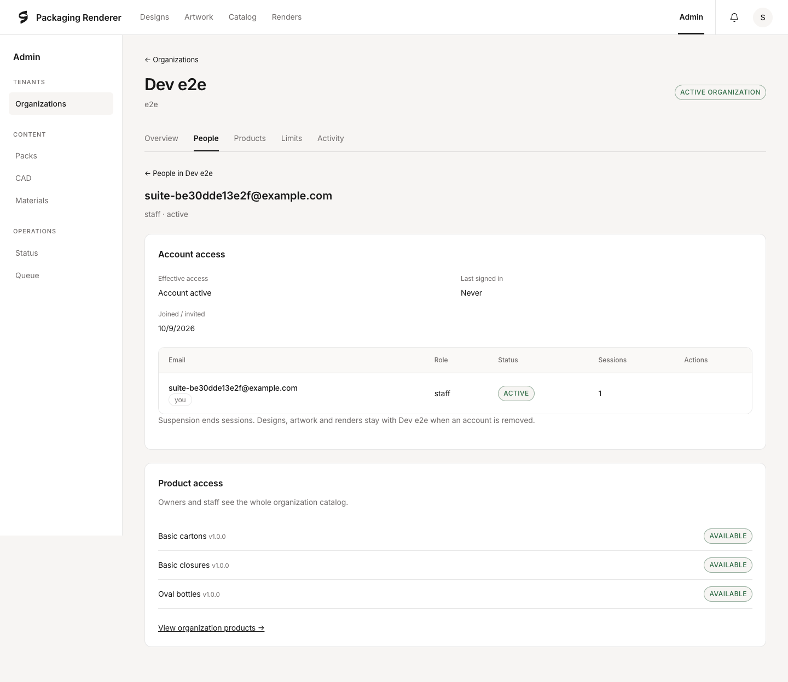

# 31 — Organization workspace

Approved approach: **Header sections**, with Organizations as the only tenant entry in the staff
sidebar. Each organization keeps its name, slug and status above Overview, People, Products,
Limits and Activity. Person detail keeps People selected and offers a return to that organization's
directory. This preserves the existing staff console and the separate owner-only `/org` surface.

## Implementation plan

- Reuse organization, account, quota, invitation and catalog services; no new runtime or migration.
- Move people controls to organization-bound person details. Add email, role and status filters
  and pagination. Keep cross-organization email lookup read-only in `/admin`.
- Reuse the five quota fields under Limits. Products reports published packs available to the
  organization and member restrictions, with links to the corresponding person.
- Show the existing audit trail under Activity, with actor and subject labels and pagination.
- Verify organization mismatches, staff-only access, filters, pagination, invitation controls,
  role confirmations, self-protection and quota saves against a disposable local database.

## Deliberately deferred

Invitation acceptance behavior, synchronization of pending invitation roles and concurrent
last-owner safeguards require separate authentication review. This UI change does not change
those policies. Delivery outcomes remain immediate responses from the existing invitation
service; a historical provider-delivery status is not inferred. Organization suspension controls,
new catalog publishing controls and moving a person between organizations are outside this change.

## Routes and workflows

| Route | Purpose |
|---|---|
| `/admin` | Organization directory, organization filters, read-only paginated email lookup |
| `/admin/orgs/[id]` | Overview: account counts, renders today, organization access, first-owner shortcut |
| `/admin/orgs/[id]/people` | Paginated people, email/role/status filters, invite dialog |
| `/admin/orgs/[id]/people/[userId]` | Account controls, sign-in metadata, invitation expiry, active-owner warning, product-access readout |
| `/admin/orgs/[id]/products` | Organization's published catalog and member restrictions |
| `/admin/orgs/[id]/limits` | Five existing quota fields and explicit save feedback |
| `/admin/orgs/[id]/activity` | Paginated audit records, actor/subject labels and expandable metadata |
| `/admin/users?q=...` | Compatibility redirect to `/admin?q=...` |

Lists show 50 rows per page. Counts are queried independently of the page, so there is no
200-person truncation. Filters persist through pagination; stale page numbers clamp to the last
available page. Malformed filter values fall back to defaults, and malformed organization/person
IDs return 404. Person reads and staff writes carry the selected organization; a mismatched
organization/account pair returns 404 without changing the account or recording a mutation.

Staff controls retain their existing endpoints and permission checks. The optional `orgId` query
on account mutations is backward compatible for existing API callers. Invitation resend/revoke
already carry `orgId`. Deleting or revoking a person returns to their organization's People list.
Product access here is a readout, not a second editing or publishing path. Session counts exclude revoked, absolute-expired and idle-expired sessions; this corrects the readout without changing session validation.

No authentication policy, database schema, queue, storage or worker behavior changes. The web app
now declares the same Zod version already used by workspace packages for URL boundary validation.

## Verification

Local verification uses PostgreSQL and Chrome, a production web build, a disposable test database
and absolute object-storage path. The real development database is not used for browser fixtures.
Test workers are separate from the development workers. Blender startup crashes under the macOS
restricted sandbox; the complete unit/integration suite passes with host access.

- `pnpm test`: 1,388 passed, 7 skipped (101 test files; host access).
- `pnpm -r typecheck`, `pnpm lint`, `pnpm check:env`: passed.
- Production web build: passed.
- Focused Admin and Organization browser suite: 24 passed. Includes 205-account pagination,
  malformed IDs, organization mismatches, read-only lookup redirects, confirmations, invite
  outcomes, resend/revoke, accepted-account suspend/restore/delete, self-protection, quotas,
  section navigation and narrow-screen overflow checks.
- Full browser suite with real Cycles and OCCT workers: **157 passed, one failed** (158 cases).
  The failing prepared-carton preview/render acceptance check has mean SSIM 0.208 and local
  aggregate -0.713 against floors 0.8 / 0.35. Its captured preview shows the selected mark;
  the carton render does not. This matches the existing unresolved case and earlier baseline
  and legacy-upload comparisons in [29](29-artwork-preparation.md) and [30](30-workspace-reskin.md).
  This change does not touch the preview, carton compositor or renderer. The full suite is not
  declared green; investigating/fixing the renderer requires separate scope approval.
- Bundle budgets: passed (shell 100.1 / 180 kB gzip, editor 525.9 / 700 kB).
- Actual production pages were rendered in Chrome browser tests; desktop person detail and narrow
  People layouts were visually inspected. No preview probe was run because this change only
  affects organization administration and does not change the 3D viewport.
- Disposable test database, storage, workers and account fixtures were removed. The original
  development database/storage and workers were preserved, and port 3000 returned to development
  mode. After restoration, `/api/health` returned `{"status":"ok"}`; the database reported one
  live CAD worker and one live render worker. Port 3000 is listening; ports 3001 and 3100 are
  closed. No disposable browser-test database remains.

## Implemented appearance

## Verification

- Fresh unit/integration suite: 1,388 passed, 7 skipped.
- Typecheck, lint, environment documentation, production build and bundle budgets: passed.
- Fresh Admin/Organization browser suite: 24 passed against a disposable database, storage and
  production server on port 3112; shared servers on ports 3000/3100 were left running.
- The first browser run exposed a hardcoded port in the new account-lifecycle test. It now uses
  the page origin; the complete focused suite passed on rerun.
- The full rendering/browser suite was not repeated for this admin-only change; its earlier
  prepared-carton parity failure remains recorded above.

The screenshot below is from the actual production build using disposable example accounts.

