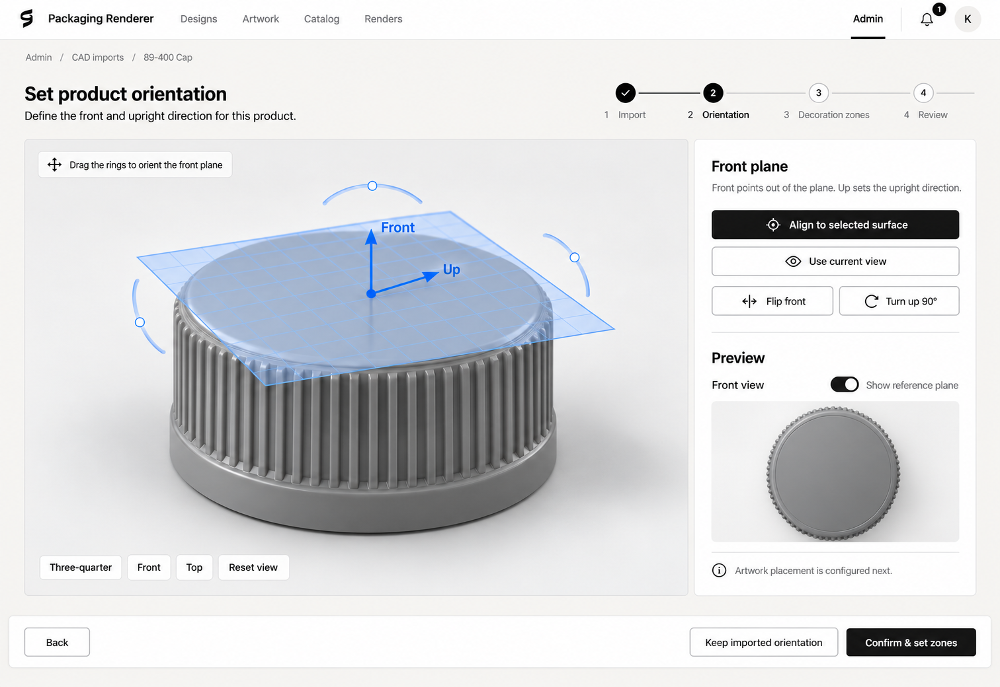

# Product orientation and consistent viewer lighting

Project requirements and workflow specification · Revision 2

**Status: review build implemented; legacy regression decisions pending.** The recommended baseline is being implemented with additive orientation metadata, immutable published defaults, staged design overrides and temporary inspection. Final lighting aesthetics require user review of actual frames.

## 1. Purpose and intended result

Give each imported product an explicitly confirmed **Front** and **Up**, then use that frame consistently for camera presets and studio lighting. Let users revisit orientation through the same guided interface used during initial setup.

The application must work with arbitrary supported CAD geometry, rather than assuming every product is a cap, upright bottle or carton. A shirt-shaped model with front and back decoration is a useful design example; this work does not add garment simulation or new import formats.

The desired viewer appearance is the well-lit cap in the selected concept: readable surface detail, soft highlights, clear silhouette and visible relief on the facing surface. The concept is a visual target, not a photograph of the current WebGL renderer. Orientation consistency and lighting quality are separate requirements: confirming Front alone will not create that appearance.

Success means:

- A staff user can upload a CAD file, confirm its orientation, configure decoration zones and review the product before publishing it.
- Front, Top and Three-quarter have predictable meanings for every newly configured product.
- Equivalent parts imported along different source axes receive equivalent framing and illumination after orientation is confirmed.
- Emboss/deboss and texture remain legible across the agreed review angles and materials, without altering the user's physical finish or material to manufacture contrast.
- Reorientation is understandable, reversible and preserves artwork placement, dimensions and published history.
- Browser preview and exported render resolve orientation through the same shared contracts.

## 2. Existing behavior and the problem

The inspected implementation uses Next.js, browser-side three.js/WebGL, shared TypeScript packages, a CAD worker and a separate Blender/Cycles render worker. Interactive frames are rendered on the user's computer. Render exports are asynchronous worker outputs; this feature does not introduce streamed server rendering.

Current CAD setup is staff-only. A processed upload offers **Draft a pack**, asks for catalog metadata and then links directly to **Add its zones**. Derived meshes, assembly parts, bounds and provisional camera presets are available at that point. There is no dedicated semantic Front/Up confirmation step.

Current camera presets are spherical around world axes, and the existing studio directions are also world-based. The real 89–400 cap's selected planar zone faces approximately +Z, while the fixture cap's decorated top faces +Y. Matching the screen's apparent head-on view therefore does not guarantee matching illumination.

Current product variants contain dimensions, assets, material slots, zones and camera presets. Saved designs pin a product/pack version and hold their own camera, material and placement settings. Published pack zone geometry is immutable; even draft zones cannot be moved or removed when used by designs. The proposed feature must respect those guarantees.

An isolated lighting experiment already compares Current, A Detail, B Camera-relative and C Rotate. It is inspection-only and does not save or export its settings. Its preliminary fixture results do not establish production quality on the user's actual imported cap.

### Evidence and limitations

This spec is grounded in the inspected implementation and the existing lighting experiment. It is not a claim that the orientation workflow or its proposed production lighting has been implemented or tested. Source references are listed in section 17. Recheck integration points against the current main branch before implementation, because other application work is in progress.

## 3. Scope and approval boundary

### Selected UI direction

The user has selected:

- A guided full-page workflow with an editable reference plane and Front/Up indicators.
- The application's exact existing global header.
- Location breadcrumbs at the top left and a four-step progress indicator at the top right.
- A large interactive viewer, right-side controls and a live Front preview.
- Three-quarter, Front, Top and Reset view camera buttons from the main viewer.
- The same steps and interface for initial orientation and later reorientation.
- Viewer lighting that approaches the clearly illuminated concept render.

### Proposed functional scope

| Requirement | Proposed deliverable                                                                                                                        |
| ----------- | ------------------------------------------------------------------------------------------------------------------------------------------- |
| ORI-01      | Confirm a valid Front/Up frame for each newly authored product variant before publication.                                                  |
| ORI-02      | Insert Orientation between processed CAD import/draft creation and decoration-zone authoring.                                               |
| ORI-03      | Implement the selected plane, surface alignment, current-view alignment, camera controls and live preview.                                  |
| ORI-04      | Reopen the same guided flow for reorientation, retaining imported geometry and existing configuration.                                      |
| ORI-05      | Resolve cameras, lighting and presentation guides through shared orientation math without modifying source geometry or artwork coordinates. |
| ORI-06      | Preserve legacy designs, historical jobs and published product versions.                                                                    |
| ORI-07      | Apply existing authorization and versioning rules to every read and write.                                                                  |
| LGT-01      | Validate and introduce an orientation-aware production studio profile after actual-part visual review.                                      |
| LGT-02      | Provide an explicit artwork-inspection mode for surfaces that differ from the product's primary Front.                                      |
| LGT-03      | Evaluate optional manual light rotation; keep camera-relative lighting an experiment unless separately selected.                            |
| DOC-01      | Update workflow, GUI, schema, preview, render and feature-inventory documentation with the implementation.                                  |

These are specification-local IDs, not already registered feature IDs. Before coding, allocate available IDs in `docs/01-features.md` and map these requirements to them.

### Deliberately excluded

This project does not redesign global navigation, change SVG sanitization or color selection, repair unrelated zone projection defects, rewrite the CAD importer, introduce another service or runtime dependency, add a CAD modeling tool, or add cloth simulation. Those changes solve different problems and would require separate review. Existing supported file formats remain supported; no new formats are promised here.

The deprecated liner is not given new controls or rendering behavior. A broader accessibility initiative remains outside this work under the repository's standing backlog decision. Existing interaction and UI component conventions still apply.

## 4. Concepts and coordinate contract

| Term                | Meaning                                                                                                                                                                                            |
| ------------------- | -------------------------------------------------------------------------------------------------------------------------------------------------------------------------------------------------- |
| Source space        | The assembled imported mesh coordinate system used by existing geometry, bounds, zones and physical measurements. Import-time unit conversion already established by the CAD pipeline is retained. |
| Product Front       | The outward direction the author wants a viewer to face when choosing Front. It is user-confirmed, not inferred from a filename or symmetry axis.                                                  |
| Product Up          | The upright direction within the Front plane. It fixes the roll of the Front view.                                                                                                                 |
| Reference plane     | A visual orientation aid. Its normal is Front and its vertical direction is Up. It is not a decoration zone, clipping plane or physical surface.                                                   |
| Product frame       | An orthonormal, right-handed basis derived from confirmed Front and Up.                                                                                                                            |
| Zone frame          | An existing decoration coordinate system used to place artwork on a particular surface. It remains independent of product Front.                                                                   |
| Camera view         | A viewing position, target, roll and lens. Orbiting changes the view; it does not redefine product orientation.                                                                                    |
| Inspection lighting | An explicitly selected viewer aid for evaluating relief on the active artwork surface.                                                                                                             |

### Required invariants

Front points **perpendicularly out of the reference plane**. Up lies **within the plane**. Those arrows must never be exchanged to make a cap look conventionally upright: a cap's decorated top may be its semantic Front even though another product's Front is a vertical side.

Store authoritative Front and Up vectors in source space. Normalize Front; remove the component of Up along Front and normalize the remainder; derive Right as `Up × Front`. Derive rotation matrices/quaternions from that basis rather than storing competing authoritative values. Reject non-finite, zero-length or effectively parallel input vectors. A small numerical normalization is acceptable; a materially ambiguous frame requires correction rather than a silent guess.

The proposed implementation leaves mesh and zone coordinates unchanged and transforms **camera and light definitions from product-frame coordinates into source space**. Share this resolver between preview and export. This avoids one transform for the part and a different transform for its logo. Any later decision to instead transform the full scene must replace this approach consistently, not coexist with it.

Use the variant's existing assembled bounding-sphere center as the default camera/light target and display-plane anchor. Selecting a surface changes directions, not the model's origin. A picked point is a temporary selection marker; it does not become a new persisted pivot.

Physical size, CAD assembly transforms, normals, UVs, material-slot identity, artwork offsets, relief depth and manufacturing clearances must remain unchanged. Reorientation is a presentation operation, not a repair or dimensional edit.

## 5. Roles, entry points and change scope

The authorized implementation separates a catalog orientation default from a staged design-specific override. Applying an override changes only that design; staff draft setup changes a future catalog version.

| Actor and entry point                                      | Allowed result                                                                             | Restrictions                                                                           |
| ---------------------------------------------------------- | ------------------------------------------------------------------------------------------ | -------------------------------------------------------------------------------------- |
| Staff, successful CAD ingestion                            | Create/continue a draft and confirm orientation for its selected variant.                  | Preserve existing staff-only CAD access, metadata requirements and import diagnostics. |
| Staff, draft pack/variant                                  | Continue setup or change its orientation.                                                  | Do not move a referenced zone; changes must use the established draft/version policy.  |
| Staff, published pack/variant                              | Start orientation changes in a new draft version, or reuse the appropriate existing draft. | Never edit the published manifest in place or silently repoint existing designs.       |
| Authorized design editor, proposed Reorient product action | Store a presentation override in a new saved design version.                               | Does not edit the catalog default, zones, source CAD or other designs.                 |
| Read-only design user                                      | See the effective orientation and ordinary camera controls.                                | Cannot save an override; controls that mutate orientation are unavailable.             |

For catalog entry, add **Set orientation** or **Reorient** to the existing variant/zone authoring context, with a clear variant name. Preserve the existing Zones entry and authoring tools. For the design entry, place **Reorient product** with product/view settings, separate from SVG Rotate. It must not be confused with rotating artwork or simply orbiting the camera.

Before editing, show a short scope message: **“Default orientation for this product variant”** in staff setup, or **“Orientation for this design only”** in design reorientation. Users should understand scope without seeing implementation vocabulary.

## 6. Page structure and visual requirements

The reference below is the selected concept, with behavior clarified by this specification.



Use the existing application design system: white surfaces, restrained neutral background, black primary actions, consistent stroked icons, borders, radii, typography and spacing. Pale blue is reserved for the editing plane, arrows, selection and manipulation handles. Do not add a new design language for this workflow.

Desktop structure:

1. Existing global header.
2. Location breadcrumbs.
3. Title/subtitle and four-step indicator on the same content row where space permits.
4. Main viewer and right inspector, approximately 70/30 of available content width.
5. Persistent action footer that does not cover the canvas controls or inspector content.

At narrower sizes, stack the inspector below the viewer, wrap the step labels and keep all actions reachable through normal page scrolling. Do not squeeze the editor into an unusably thin viewport. Use existing responsive breakpoints; avoid prescribing another independent layout system.

### 6.1 Global navigation, location and progress

| UI element                            | Function and states                                                                                                                                                                                                                       |
| ------------------------------------- | ----------------------------------------------------------------------------------------------------------------------------------------------------------------------------------------------------------------------------------------- |
| Brand/logo                            | Reuse the current brand component and Designs destination. No replacement icon or wordmark.                                                                                                                                               |
| Designs / Artwork / Catalog / Renders | Reuse current order, routes and active-state behavior.                                                                                                                                                                                    |
| Admin                                 | Keep the existing right-side, staff-only link and divider. It is active for admin setup routes.                                                                                                                                           |
| Notifications and account avatar      | Reuse current components, positioning and behavior. Do not invent an extra avatar dropdown indicator.                                                                                                                                     |
| Location breadcrumbs                  | Staff example: `Admin / CAD imports / 89–400 Cap`. Earlier segments navigate to their existing destinations; current item is text. Pack entry uses its actual route context. Design reentry uses `Designs / [design name] / Orientation`. |
| Title                                 | “Set product orientation” initially; “Reorient product” on reentry. Same body interface.                                                                                                                                                  |
| Subtitle                              | “Define the front and upright direction for this product.” Include the scope message from section 5 nearby.                                                                                                                               |
| Step 1: Import                        | Contains upload/processing, import diagnostics and required draft metadata. Shows complete only once usable derived assets and a draft exist.                                                                                             |
| Step 2: Orientation                   | Active while editing Front/Up. Complete only after a confirmed frame is saved.                                                                                                                                                            |
| Step 3: Decoration zones              | Contains existing zone setup and material-slot/default-material review, grouped as described in section 8.                                                                                                                                |
| Step 4: Review                        | Shows the final presentation, setup summary, remaining diagnostics and mode-appropriate completion action.                                                                                                                                |
| Step dots/connectors                  | Distinguish complete, current, pending and blocked/error states using existing visual conventions. Numbered pending dots and a check on completed steps match the concept.                                                                |
| Step navigation                       | Completed/reachable stages may be revisited. Future stages cannot bypass required saves or validation. Backtracking never deletes completed work.                                                                                         |

All page navigation away from an unsaved orientation candidate must use the same discard/stay choice as Back. Keep standard links so normal application navigation remains available.

### 6.2 Main viewer and selection

| UI element               | Required behavior                                                                                                                                                                                                     |
| ------------------------ | --------------------------------------------------------------------------------------------------------------------------------------------------------------------------------------------------------------------- |
| Product model            | Render actual derived geometry and current materials in the browser. Keep assembly parts and their transforms together. Do not replace the real preview with a concept image.                                         |
| Viewer background/studio | Use the production candidate lighting and existing background settings. Setup without real material assignments must say “Preview material”; never silently save the neutral preview appearance as a material choice. |
| Reference plane          | Translucent grid centered on the product target, sized to remain readable around the part. It may visually intersect the mesh but never clips or changes it.                                                          |
| Front/Up arrows          | Label both clearly; Front is normal to the plane and Up tangent to it. Screen labels remain readable while orbiting.                                                                                                  |
| Rotation rings/handles   | Dragging rotates the candidate plane. The mesh stays in source space; the live Front preview follows the candidate. Manipulation must preserve a valid right-handed frame and never introduce translation or scale.   |
| Interaction helper       | “Drag the rings to orient the front plane.” During surface picking, replace it with “Select a surface to use as the front.”                                                                                           |
| Orbit/pan/zoom           | Use the current viewer gesture conventions. Dragging a handle exclusively edits the plane; dragging empty space orbits. Do not let one gesture perform both actions.                                                  |
| Surface highlight        | Temporary hovered/selected geometry feedback during alignment. Selection is not a new zone and does not alter the mesh.                                                                                               |
| Cancel surface selection | Escape or an explicit Cancel action returns to orbit mode without changing the candidate. Reuse existing interaction patterns.                                                                                        |
| Loading state            | Show a model-loading placeholder; disable alignment and confirmation until required geometry is ready. A failed asset request presents Retry and a route back to the draft/import.                                    |
| Empty/invalid geometry   | Explain that no usable model is available. Do not allow confirming an invisible product or pretend the CAD stand-in is the actual source geometry.                                                                    |

The main viewport remains an orbitable inspection view while the plane is edited. The inset Front preview is the immediate feedback on what the candidate means. Choosing a camera preset explicitly snaps the main viewport to that candidate frame; continuous plane dragging must not fight the user's orbit controls by snapping the main camera repeatedly.

### 6.3 Inspector: Front plane controls

| UI element                       | Required behavior                                                                                                                                                                                                                               |
| -------------------------------- | ----------------------------------------------------------------------------------------------------------------------------------------------------------------------------------------------------------------------------------------------- |
| “Front plane” heading and helper | “Front points out of the plane. Up sets the upright direction.” This is the geometric contract, not a cap-specific explanation.                                                                                                                 |
| Align to selected surface        | Enter surface-pick mode. On selection, use a geometric surface normal transformed into assembled source space as candidate Front. Planar surface selection is preferable when available. Preserve the previous Up projected onto the new plane. |
| Ambiguous surface alignment      | For curved surfaces, explain that the picked local normal is a starting direction. For two-sided/open geometry, keep Flip front available and do not claim an unambiguous outside. Do not average unrelated ribs/faces into a semantic front.   |
| Degenerate Up after alignment    | If the old Up projects to almost zero, leave confirmation blocked and ask the user to establish Up through rings or Use current view. Do not silently roll the product to an arbitrary orientation.                                             |
| Use current view                 | Set Front from the camera target toward the camera, and Up from the camera's screen-up direction projected onto the perpendicular plane. Ignore camera distance, pan and lens when saving orientation. It changes the candidate only.           |
| Flip front                       | Reverse Front while retaining valid Up. Recompute Right. This is a rotation of the orientation basis, not a reflection or negative mesh scale. Two clicks restore the same frame.                                                               |
| Turn up 90°                      | Rotate Up by one clockwise quarter-turn as seen in Front view, around the unchanged Front axis. Four clicks restore the original frame within numerical tolerance.                                                                              |
| Restore starting orientation     | Secondary text action to discard plane edits back to the frame loaded when entering the wizard. Clearly distinct from Reset view. New setup starts from the imported-axis candidate; reentry starts from the saved effective frame.             |

All these controls update the same candidate state. None saves to the catalog or design immediately. If orientation undo/redo is included, it must use existing local command patterns; a new generic undo framework is not required for this feature.

### 6.4 Camera controls and Front preview

| UI element           | Required behavior                                                                                                                                                                                 |
| -------------------- | ------------------------------------------------------------------------------------------------------------------------------------------------------------------------------------------------- |
| Three-quarter        | Snap to a consistent oblique view expressed in the candidate frame, using existing lens/framing conventions. Reuse the existing preset definition where possible.                                 |
| Front                | Place the camera outward along candidate Front, looking at the product target, with candidate Up upright.                                                                                         |
| Top                  | Place the camera along candidate Up looking toward the target; use `−Front` as screen up to avoid a singular camera basis. Its meaning is the confirmed product frame, not an assumed CAD Y axis. |
| Reset view           | Restore the wizard's default Three-quarter framing for the current candidate. Does not reset orientation, zones, materials or artwork.                                                            |
| Lens/zoom            | Reuse existing viewer controls if shown. They affect camera/framing only. Orientation saves do not overwrite a design's lens unless the user explicitly chooses the new camera in Review.         |
| Front preview        | Small live view of the same mesh/materials, target and candidate studio. Camera is always aligned to candidate Front/Up. No independent orbit, manual lighting rig or static screenshot.          |
| Show reference plane | Show/hide plane, grid, arrows and rotation handles in the main editing viewport. The Front preview remains a clean product view. Hiding the aid never changes or clears the candidate.            |
| Preview guidance     | Explain that artwork placement is configured next. In reorientation, already configured artwork stays visible where supported; it is not recreated.                                               |

Implement both views using shared scene state and helpers. Share loaded assets and derived buffers where practical; do not trigger a second CAD conversion, duplicated artwork-map derivation or environment rebuild per preview frame. Preserve the application's device quality adaptation.

### 6.5 Footer actions and feedback

| UI element                | Initial setup                                                                                                                                       | Reorientation                                                                                                                                                                             |
| ------------------------- | --------------------------------------------------------------------------------------------------------------------------------------------------- | ----------------------------------------------------------------------------------------------------------------------------------------------------------------------------------------- |
| Back                      | Return to Import/metadata without deleting the upload or draft. Unsaved candidate offers Stay or Discard changes.                                   | Return to completed Import summary or the preceding stage in the same wizard; no reupload required. Leaving the wizard returns to its entry context.                                      |
| Keep imported orientation | Explicitly confirm source-axis Front = +Z and Up = +Y after showing its preview, then save and continue. This is a confirmation, not a hidden skip. | Explicitly preview source-axis orientation. Warn that this differs from a catalog default or design override before confirmation; persist only through the normal save action.            |
| Confirm & set zones       | Validate and save the candidate to the selected draft variant, then advance. No navigation if saving fails.                                         | Save the candidate to the applicable draft/temporary design workflow state, then advance to the same zone-review stage. Does not immediately publish or replace an existing saved design. |
| Saving state              | Disable duplicate submissions, show progress and retain the candidate until acknowledged.                                                           | Same behavior.                                                                                                                                                                            |
| Success state             | Mark Orientation complete only after server confirmation.                                                                                           | Same behavior; scope remains visible.                                                                                                                                                     |
| Error state               | Inline actionable error and Retry. Keep the user's candidate intact.                                                                                | Same behavior; distinguish permission, conflict and validation errors.                                                                                                                    |

The proposed design-override flow stages changes until final Review. Confirm & set zones may retain the candidate in the mounted wizard without creating a design version yet. If the user reloads before Apply, show a discard warning before the reload where the browser supports it; reopening after a lost session uses the last saved design. Do not label an in-memory candidate “saved.” Product drafts, in contrast, persist orientation at this step and can resume after reload.

## 7. End-to-end workflows

### 7.1 New CAD product


1. Staff opens Admin → CAD imports. Keep current file checks, upload limits, processing profile, queue progress, job logs, cancellation and error reporting.
2. A successful import shows dimensions, part count, geometry diagnostics and derived asset readiness. Expensive processing remains asynchronous. Failed/canceled jobs cannot enter orientation setup.
3. Staff uses Draft a pack and supplies the existing pack/product/variant keys, names and category. Do not infer semantic names from geometry.
4. Create the draft using the existing CAD-to-pack operation. Replace the immediate “Add its zones” destination with **Continue setup**, entering Orientation. Existing drafted-result links also route to the next incomplete stage.
5. Display the actual model, imported-axis candidate and available diagnostics. Staff picks a surface, uses the current view or drags rings, then checks Front/Top/Three-quarter and the Front preview.
6. Confirm & set zones saves the frame. Keep imported orientation is an equally explicit confirmed choice; it does not waive review of the visual result.
7. Decoration zones reuses existing authoring: add, name and validate zones, limits and finish permissions. Material slots retain existing identities; staff reviews their default material assignments and unresolved placeholder-material notes.
8. Review presents the chosen orientation, camera views, zones, materials, asset/repair diagnostics and setup completion. Staff can go back without losing saved draft work.
9. Publish uses the established staff publishing operation and its checks. This must be a deliberate action, never a side effect of confirming Front.

Opening a job with several previously drafted packs must keep each pack/version destination distinct. Orientation setup does not create another pack merely because the user returns to a completed ingestion.

### 7.2 Resume an incomplete draft

Expose Continue setup from the ingestion and draft pack context. Resolve the earliest incomplete stage from server state: missing usable asset → Import; unconfirmed orientation → Orientation; incomplete zone/material requirements → Decoration zones; otherwise Review. A bookmarked reachable stage remains usable, subject to validation.

Changing orientation after zones exist does not delete them. Their physical source-space frames and mm placements stay unchanged. Mark the visual Review step as needing another review; do not mark valid physical zone dimensions invalid merely because the presentation frame changed.

### 7.3 Reorient a catalog product

1. Staff chooses Reorient for a named variant.
2. If published, use the existing new-draft-version flow. Reuse the relevant existing draft when safe and identify it clearly; do not silently fork multiple drafts.
3. Reopen the same four-step wizard at Orientation. Import is complete and shows a read-only source/asset summary. Its asset references are reused.
4. Start from the draft/saved frame. Review changes in the Front preview using exactly the same controls as initial setup.
5. Continue to Decoration zones. Retain zones, materials, limits and asset references; allow ordinary draft editing only where existing policies permit it.
6. Review and publish the new version explicitly. Existing designs keep their pinned version and appearance. Upgrading a design to a new product version is a separate explicit workflow, not an automatic side effect.

### 7.4 Reorient a single design

1. An authorized editor chooses Reorient product from the design's product/view controls. Resolve or explicitly discard any current unsaved design edits before entering the wizard.
2. Display the same layout and four stages. Import is a completed read-only summary of the pinned variant. Start Orientation from the effective frame: design override, then confirmed variant default, then legacy behavior.
3. Allow the same plane and preview operations. Show “This design only.” Keep the original saved document as the cancel baseline.
4. Decoration zones is a review stage: existing zone selection and artwork can be inspected, but catalog zone geometry/material-slot definitions are not editable here. Materials/placements retain their saved design values.
5. Review shows the old and proposed Front views and explicitly states that artwork position/size and product dimensions are preserved. Offer the camera decision from section 9.
6. **Apply to design** saves through the existing authorized, versioned design-save path; return to the editor with its effective orientation. Cancel discards staged changes and returns to the unchanged design.
7. A secondary **Use product default** action clears the override through the same Review/Apply flow. It restores the pinned variant's default, not whichever product version is latest in the catalog.

These scope-specific read-only states and final action labels do not create a different interface. They are permission adaptations of the same steps, components and orientation controls.

### 7.5 Multiple variants, assemblies and surfaces

Confirm orientation per variant. Never assume different variants share source axes. A future explicit copy operation may validate matching frames, but bulk copying is outside the first delivery.

Orientation applies to the assembled product as a whole, not one mesh part independently. Selecting a surface on an assembly provides a direction for that whole product. Existing part material assignments and transforms remain intact.

A product has one primary Front for navigation. Its back, curved sides and other decoration surfaces retain their own zone frames. Use explicit artwork-inspection lighting for those surfaces; a single Front must not flatten all surfaces into one orientation or redefine their 2D placement coordinates.

## 8. Import, authoring and review changes elsewhere

| Application area                | Required change                                                                                                                                                                                             | Existing behavior to retain                                                                                                   |
| ------------------------------- | ----------------------------------------------------------------------------------------------------------------------------------------------------------------------------------------------------------- | ----------------------------------------------------------------------------------------------------------------------------- |
| CAD imports list and result row | Continue setup/Resume setup links replace direct zone-first progression; show orientation status for each drafted variant.                                                                                  | Upload, cancel/retry, diagnostics, job logs, historical ingestion entries and Draft another pack.                             |
| CAD draft creation              | Initialize an unconfirmed imported-axis candidate and retain diagnostic context. Replace the misleading “re-orient mesh at ingestion” guidance with a link/instruction to confirm presentation orientation. | Derived geometry, units, source provenance, bounds, dedupe/asset references and material-slot construction.                   |
| Pack/variant admin              | Add orientation status and scoped Set orientation/Reorient entry; route published changes through a new draft.                                                                                              | Existing Zones controls, draft/published/deprecated states and version actions.                                               |
| Zone authoring                  | Display consistent orientation-aware cameras and studio. Convert pick results into existing source-space zone frames.                                                                                       | Zone keys, physical frames, sizes, constraints, finish options and referenced-zone protections.                               |
| Material-default authoring      | Place the existing default-material review in step 3, clearly separated from zone editing. Link to existing material administration for missing definitions.                                                | Real material properties, slot identities and current allowed-material/finish policies.                                       |
| Publish operation               | Validate orientation confirmation for newly authored oriented variants and show unresolved diagnostics before publication.                                                                                  | Existing publish validation, authority and version behavior. Legacy publish paths need a reviewed transition.                 |
| Catalog and product selection   | Use the confirmed frame for new default views and thumbnails; show orientation status in authoring contexts.                                                                                                | Browsing, filters, product/variant selection and pinning semantics.                                                           |
| Design editor                   | Resolve effective orientation; optionally add the approved design reentry action and explicit inspection mode.                                                                                              | Place/Split/Look, guides, snapping, all SVG transforms, materials, finishes, autosave, undo/redo, render controls and limits. |
| 2D artwork/face view            | Keep its zone-space orientation and measurements. Presentation orientation must not rotate SVG pixels or rewrite placement values.                                                                          | Existing artwork gallery, upload/color selection and shape-edit workflows.                                                    |
| Main camera controls            | Interpret new orientation-aware presets through the frame. Preserve legacy/custom cameras using versioned semantics.                                                                                        | Current controls and lens/framing behavior; no silent camera resets.                                                          |
| Cross-sections and guides       | Keep the existing named-cut semantics and source geometry; render guides with the same scene resolution. Confirm no clipping plane or normal is transformed twice.                                          | Existing section selection, clearances, rulers and preview-only restrictions.                                                 |
| Thumbnails/design cards         | Regenerate only for an explicitly changed draft/design version; cache by effective appearance inputs.                                                                                                       | Historical thumbnails, pinned designs and existing write permissions.                                                         |
| Image export; future video math | Resolve image cameras/studio with the same orientation contract and capture immutable job inputs. Update the shared turntable helper only; video export remains backlogged.                                 | Quality presets, formats, alpha, job lifecycle and deterministic render identity.                                             |
| Source/object storage           | Reuse derived assets; no orientation-only CAD conversion or source-file rewrite.                                                                                                                            | Authorized access, source CAD privacy, existing storage paths and retention policy.                                           |

### Step 3 and step 4 detail

The selected four-dot sequence must not drop material setup. Proposed step 3 heading remains **Decoration zones**, with two clearly separated sections: Zones and Material defaults. Review summarizes both. This grouping needs approval in section 16.

Review must include product/variant identity; effective Front/Top/Three-quarter previews; explicit orientation confirmation; zone names/types and configured limits; material defaults or design assignments as applicable; import repairs/open-shell warnings; and mode-specific actions. Do not hide existing diagnostics in a wizard completion badge.

Initial/draft setup uses **Save draft** and the existing **Publish** action when eligible. Design override uses **Apply to design**. Published reorientation publishes a new version. All review stages provide Back and direct revisiting of reachable setup stages.

Orientation alone does not make a product eligible for publication. Use existing zone/material validity requirements and explicitly resolve placeholders according to current publishing policy. Any stricter requirement for non-decoratable variants or placeholder materials must be decided during implementation planning rather than silently invented here.

## 9. Persistence, cameras and backward compatibility

### Proposed data contract

Add a versioned presentation-orientation field to each product variant. Recommended conceptual shape:

```text
presentationOrientation
  frontSource: unit vector
  upSource: unit vector orthogonal to frontSource
  confirmed: boolean

design.scene.presentationOrientationOverride (optional)
  frontSource: unit vector
  upSource: unit vector orthogonal to frontSource
```

Names are illustrative; concrete schema/API changes require implementation review. Store confirmation/audit details through existing catalog/audit mechanisms rather than inventing a second history system. Do not persist source-alignment pointers that will be fragile across mesh LODs unless a concrete use requires them.

The frame is stored per variant per pack version. A design override, if approved, is stored in the versioned design document. UI preferences such as selected ring, helper visibility, surface hover and wizard orbit position are temporary state. They must not affect the render hash.

The proposed studio contract also needs an explicit, versioned frame/profile interpretation so older environment keys do not suddenly mean different light directions. Effective precedence is: design override → confirmed pinned variant frame → legacy resolver. An unconfirmed imported-axis candidate is not a confirmed product default.

### Camera behavior

New generic presets are defined in product-frame coordinates and resolved into source-space cameras through shared `packages/scene` math. Keep existing lens, framing and target-offset conventions. Source-space custom cameras remain source-space; do not reinterpret them because an orientation field exists.

On reorientation, Review offers:

- **Keep current view** — recommended default for an existing design; preserve the resolved position, target, up and lens. If a preset's new meaning would move that camera, preserve the old resolved view as a custom camera.
- **Use new Front view** — explicitly replace the camera with a candidate-frame Front preset while retaining the lens unless changed by the user.

Preset labels remain user-facing camera choices. Existing pack-specific presets must be classified as legacy/world-space or orientation-aware rather than globally assuming all historical azimuth/elevation values were authored in product space.

Turntables for new oriented designs orbit the confirmed Up axis and begin from the declared Front-relative azimuth. Legacy turntables keep their previous world-axis behavior. Existing custom output cameras must not be changed by a default-frame update.

### Legacy and published content

Schema migrations must be pure on read and retain historical visual behavior. Missing orientation fields mean **legacy semantics**, not automatic rotation or inferred Front. Old pack manifests, saved designs, output requests and immutable job specs must continue to load.

Newly created/imported variants require explicit confirmation under the new workflow. Existing variants are marked “Orientation not configured” in authoring UI, not invalidated in customer designs. Upgrading them is explicit staff work, with a new pack version for published content.

Saved render jobs keep their captured inputs. The worker must not look up a mutable latest orientation. New appearance-changing frames/studios produce new design/job identities; historical rendered files are not replaced.

Before altering schema versions, preset meaning, environment defaults or publishing validation, present the exact compatibility behavior and migration options for approval. These are potentially breaking changes under the standing collaboration rules.

## 10. Lighting requirements and decision process

### Production baseline recommendation

Use a **product-relative studio** for normal viewing: oblique key, restrained fill, reflected light sources and a separating rim, oriented to confirmed Front/Up. Scale source distances/sizes using the existing bounding-sphere conventions. Direct illumination and reflected environment must use the same orientation and rotation.

During orbit, this rig stays fixed relative to the product frame so reflections move naturally across the material. Do not make camera-following illumination the default without the separate A/B/C selection review.

For artwork on another surface, offer explicit **Inspection** mode, fixed to the selected zone frame. The inspector must show this is inspection-only; activating it must not silently change saved studio settings or export appearance. **Design lighting** restores the saved lighting preset.

For zones without a trustworthy source-space local frame, use the product frame and label the fallback. Do not derive a world normal from a UV rectangle alone. Cylindrical/conformal zones use their evaluated surface frame at the selected artwork/zone center, subject to the current mapper's capabilities.

### Proposed production UI

| Element                          | Proposed function                                                                                                                                                      |
| -------------------------------- | ---------------------------------------------------------------------------------------------------------------------------------------------------------------------- |
| Lighting preset                  | Retain the saved lighting choices, including Detail. Old saved environment keys retain their meaning. |
| Design lighting / Inspection     | Always-visible joined mode buttons below Background. Inspection uses zone-relative lighting without saving a design change; Design lighting restores the selected preset. |
| Light rotation / Reset rotation  | The slider and degree value appear only while Inspection is selected. Reset rotation stays available and sets the angle to 0° without changing modes. Rotate around inspection Front, with direct lights/reflections moving together. The angle is retained when switching to Design lighting and discarded on reload. |
| Render action in inspection mode | Explain that export uses the selected lighting preset; offer Use design lighting before proceeding. Do not export unrecorded inspection state. |

Saving inspection lighting as export lighting is excluded from the baseline. If requested later, it needs an explicit Apply to scene action and fully captured render contract. The existing comparison query remains clearly experimental until production review is complete; no comparison settings are silently promoted to saved designs.

### Appearance requirements

- The facing primary surface must avoid the broad, uniformly dark/flat result shown in the user's screenshots.
- The Black Forest artwork's mountain lines, border and text relief must read on the actual green imported cap at the user's real finish settings.
- Preserve material identity: matte plastic stays matte plastic, dark green stays dark green, and shallow relief stays physically shallow. Do not boost metalness, depth, bevel or ink tint merely to pass the lighting review.
- Use directional contrast and reflected highlights to communicate form. Excess ambient fill that erases relief is not an acceptable solution.
- Review light backgrounds and product separation together. A light backdrop is not a substitute for illuminating the face.
- Existing displaced relief and height-field occlusion paths remain available; orientation must not break their quality fallback or parity. Additions such as new shadow techniques require evidence from the lighting tests, not speculative effects work.
- Setup Front preview, main viewport and ordinary design viewer must share the same candidate production studio. No special mockup-only light rig.
- “Always visible” means consistently useful in the agreed facing/oblique review views. Fully occluded, exactly edge-on or physically minute detail cannot be guaranteed visible. State that limit without artificially coloring the logo.

### A/B/C production gate

Compare Current, A fixed Detail, B camera-relative and C manually rotated Detail on identical geometry/material/finish, camera, lens, viewport and exposure. Validate on the real 89–400 CAD part as well as fixtures. Separate the effect of confirmed orientation from the effect of the studio profile: test baseline and candidate lighting under the same confirmed frame.

The default profile and whether to ship manual rotation are explicit review decisions. A + optional C is the current recommendation, not an accepted production result. Prototype code stays isolated from saved/export behavior until the required contract and migration are reviewed.

## 11. State, errors and integrity

| Condition                  | Required behavior                                                                                                                                                   |
| -------------------------- | ------------------------------------------------------------------------------------------------------------------------------------------------------------------- |
| Draft initialized          | Import complete; orientation candidate unconfirmed; future stages subject to validation.                                                                            |
| Plane edited               | Candidate dirty; Front preview updates; no catalog/design write until the applicable action.                                                                        |
| Draft orientation saved    | Persist confirmed frame and invalidate final-review completion; zones/materials remain intact.                                                                      |
| Design override staged     | Keep the original saved document and candidate separate; no design version until Apply to design.                                                                   |
| Page reload                | Product draft resumes from saved server state. Unapplied design candidate is discarded with honest messaging; no false recovery guarantee.                          |
| Concurrent modification    | Reject stale writes using an existing version/revision token or equivalent transaction check; show reload/reconcile choices. Never overwrite another edit silently. |
| Save interrupted           | Candidate stays usable; Retry does not create duplicate versions or draft packs. Confirm server state if response was lost.                                         |
| Permission/session expired | Preserve local candidate where possible, explain sign-in/permission issue and perform no unauthorized write.                                                        |
| Asset inaccessible         | Display actionable load failure; do not invent a substitute mesh or allow confirmation against a missing model.                                                     |
| Invalid orientation        | Explain the invalid Front/Up relationship; block save without clearing the user's other setup work.                                                                 |
| Variant changed            | Load that variant's own frame; warn before discarding a dirty candidate. Do not apply one candidate to another variant automatically.                               |
| Review canceled            | Saved product draft remains available; staged design override is discarded; no publication or unrelated design update.                                              |

Reuse existing request/error patterns and save transactions. Zod validation applies at HTTP, manifest/design and worker-job boundaries. Client-side validation is feedback, not authorization. Keep secrets out of logs and artifacts; use existing role/tenant policies and authorized asset access.

## 12. Engineering impact and likely integration points

This is a multi-area change, not only a new page. The following are expected integration points; confirm exact paths on current main before final coding approval.

| Area                           | Existing files/packages to inspect or extend                                                               | Reason                                                                                      |
| ------------------------------ | ---------------------------------------------------------------------------------------------------------- | ------------------------------------------------------------------------------------------- |
| Import entry and progression   | `apps/web/app/admin/cad/page.tsx`, `cad-upload.tsx`, `ingestion-row.tsx`; `/api/admin/cad/[id]/pack`       | Insert guided setup without replacing upload/worker behavior.                               |
| CAD draft output               | `packages/cad/src/draft.ts`, `packages/cad/src/contract.ts`                                                | Initialize candidate/status and update orientation guidance; retain assets and diagnostics. |
| Catalog persistence/versioning | `packages/catalog`, admin pack routes and existing versions route                                          | Validate/persist frame on drafts; enforce immutable published versions.                     |
| Shared schemas/migrations      | `packages/design-schema/src/pack.ts`, `design.ts`, `render.ts`, `migrate.ts`, pack validation              | Version orientation, camera/studio interpretation and job payloads safely.                  |
| Shared math and scene          | `packages/scene/src/camera.ts`, `environments.ts`, `bounds.ts`, `turntable.ts`, `cross-section.ts`         | One orientation resolver used by browser and export.                                        |
| Wizard UI                      | New setup route/components under existing admin pack authoring, with shared orientation body               | Reuse the selected UI for setup and reentry. Route names are a design detail to review.     |
| Zone authoring                 | `apps/web/app/admin/packs/[id]/zones/*`, `apps/web/lib/zone-authoring.ts`, `packages/catalog/src/zones.ts` | Keep source-space picks/frames and current zone protections.                                |
| Viewer/design entry            | `apps/web/components/viewport-3d.tsx`, `editor.tsx`, design route/save path                                | Apply effective frame; expose approved reentry/inspection actions.                          |
| Application shell/style        | `app-nav.tsx`, shared UI components, `workspace.css`, design-system tokens                                 | Reuse current header and styling; add only feature-specific layout.                         |
| Immutable render input         | `apps/web/lib/server/render-spec.ts`, `packages/render-spec/src/build.ts`, canonical/hash logic            | Capture effective frame, studio version and resolved appearance inputs.                     |
| Offline renderer               | `packages/blender/src/scene.ts`, `apps/worker-render/src/job.ts`                                           | Consume shared resolution; preserve old job compatibility and image/video behavior.         |
| Verification/probes            | Existing package tests, browser e2e, `scripts/lighting-probe.ts`, preview probe/parity tools               | Verify interactions, actual frames and preview/export consistency.                          |

Prefer extending existing manifest, document, catalog and save paths. No new state store, queue, orchestrator or runtime service is proposed. Add a dedicated shared math helper only for the concrete frame resolution needed by both engines; avoid a generalized CAD transform framework.

Render specifications must capture all appearance-affecting orientation/studio inputs with a versioned interpretation and include them in canonical hashing. Existing asset digests do not change for an orientation-only edit. Thumbnail/preview caches must distinguish effective orientation and studio version while retaining the original mesh cache.

A source-space custom camera, a product-relative preset and a zone-relative inspection rig must be distinguishable in code and contracts. Do not mix their coordinate meanings through a flag inferred only from whether a vector happens to point along Y or Z.

## 13. Verification and acceptance criteria

### 13.1 Deterministic tests

| Test group             | Required checks                                                                                                                                             |
| ---------------------- | ----------------------------------------------------------------------------------------------------------------------------------------------------------- |
| Frame math             | Finite/nonzero vectors; orthogonality; handedness; normal/tangent distinction; basis conversions and round trips.                                           |
| Control operations     | Flip twice and quarter-turn four times restore frame; current-view alignment matches viewing direction/roll; surface selection handles assembly transforms. |
| Equivalent source axes | Equivalent +Y-facing and +Z-facing models with confirmed equivalent frames resolve equivalent camera/light incidence in product space.                      |
| Physical invariants    | Mesh bytes/digests, assembly transforms, zone frames, artwork mm transforms, UVs, bounds and relief parameters unchanged by presentation edits.             |
| Precedence             | Design override, pinned product frame and legacy fallback resolve deterministically; clearing override restores pinned default.                             |
| Legacy compatibility   | Historical presets, custom cameras, missing orientation fields, old design schemas and old render specs preserve prior resolved behavior.                   |
| Versioning/permissions | Published edits rejected; new drafts permitted; read-only/other-tenant writes rejected; unrelated designs untouched.                                        |
| Saving/cache identity  | Stale revision conflicts; retry/idempotency; hash changes for real appearance changes; UI-only plane visibility does not change hashes.                     |
| Zones/outputs          | Planar, cylindrical, conformal and UV-only fallback; front/back zones; turntable axes; custom output cameras; cross-section/guide alignment.                |

### 13.2 Browser workflow tests

Exercise a successful processed import through metadata, orientation, zones/materials, review and publish. Check failed/canceled processing, asset load failure, save failure, unsaved navigation, reload/resume and reachable step navigation.

Exercise published-product reorientation through a new draft while an existing design stays pinned. Exercise design reorientation if approved, including cancel, Apply, clearing override, camera preservation and read-only permissions. Confirm initial/reentry use the same stage and control components.

Regression-test existing workflows: catalog selection; SVG upload/library selection; artwork color selection; 2D fit/fill/centering and transforms; material/finish controls; Place/Split/Look; save and undo/redo; sections; render submission/history/downloads; and staff pack/zone authoring. Run existing suites rather than duplicating every current test.

### 13.3 Manual visual test protocol

1. Use a controlled camera/lens/viewport and identical saved material/finish values. Record source model, effective frame, profile/rotation, exposure and device/browser for each capture.
2. Capture Current/A/B/C on the real imported 89–400 cap using the supplied Black Forest artwork, including the observed shallow deboss settings. Do not substitute a smaller fixture and call it the same test.
3. Add embossed and debossed fixtures, matte/gloss plastic, dark/light colors, a box, a curved side-zone product and an asymmetric multi-part object. A shirt-shaped supported model can be an additional genericity fixture; no cloth runtime is needed.
4. Inspect Front, Top, Three-quarter and small orbit changes around Front, plus the back/side artwork-inspection case. Include different source-axis versions of equivalent geometry.
5. Rate relief readability, text/line readability, face brightness, silhouette separation, believable material response and stability during orbit. Compare matched images; do not rely on screenshots with different cameras or finishes.
6. Review actual browser frames together and select the production profile/rotation behavior. The illustrated concept cannot substitute for these captures.
7. Produce actual Blender image output for representative cases. Video export remains backlogged (`F-REND-10`); validate the shared orientation-aware orbit helper without claiming a working turntable export. Verify camera/up, artwork location and studio orientation match the browser contract. Exact pixels are not expected from raster and path-traced engines; use existing parity criteria and document any limits.

No new numerical visual-quality threshold is invented in this spec. Establish the reference captures and approve the subjective rubric/profile before declaring the aesthetic goal met.

### 13.4 Performance and local checks

Retain existing preview quality adaptation and loading/frame budgets. Measure on the same representative device before/after adding the wizard preview and oriented lighting. Orbiting or rotating light directions must not rerun CAD conversion, regenerate artwork maps or continuously rebake an environment. Release previews and GPU resources on leaving the wizard.

Before offering implementation as complete, run:

```bash
pnpm test
pnpm -r typecheck
pnpm lint
pnpm check:env
pnpm e2e
pnpm preview:probe
```

Configure the preview probe for the actual isolated running server. `pnpm e2e` can stop an existing dev server under current tooling; coordinate it and use isolated test state so another agent's work is not disrupted. Run actual CAD and Blender integration/parity checks where available. List precisely what ran, what was skipped and whether the real worker/UI path was verified. Investigate failed checks before reporting completion.

GitHub CI must pass before merge unless explicitly waived for that PR; dispatch it if needed. Local checks do not imply unavailable integration checks passed.

### 13.5 Release checklist

- [x] New imported variants cannot bypass explicit orientation confirmation through the setup/publish path.
- [x] Exact existing header and navigation behavior retained.
- [x] Front normal and Up tangent are correct in both arrows and saved math.
- [x] Surface/current-view/ring operations, preview and camera buttons behave as specified.
- [x] Reentry uses the same interface and sequence, without reupload or conversion.
- [x] Material review and existing import diagnostics remain visible.
- [x] Reorientation changes no physical artwork/zone/mesh data.
- [ ] Existing designs, published variants and historical render jobs preserve legacy behavior.
- [ ] New orientation/studio resolution agrees between preview and actual export.
- [ ] Actual imported-cap lighting reviewed and production choice approved.
- [ ] Side/back artwork inspection and UV-frame fallback are understandable.
- [x] Save/cancel/conflict/permission failures are tested and do not lose saved work.
- [ ] Existing editor/admin/artwork/render workflows remain reachable and functioning.
- [ ] Performance and resource lifecycle verified on actual frames.
- [x] Required documentation and feature inventory updated with behavior/status.

## 14. Documentation changes accompanying implementation

| Document                                                        | Required update                                                                                                                                                    |
| --------------------------------------------------------------- | ------------------------------------------------------------------------------------------------------------------------------------------------------------------ |
| `docs/01-features.md`                                           | Register orientation/setup/reorientation and production lighting requirements with accurate planned/partial/built status. Keep the comparison experiment distinct. |
| `docs/README.md`                                                | Index the approved spec and implementation notes.                                                                                                                  |
| `docs/02-workflows.md`                                          | CAD processing → metadata/draft → orientation → zones/materials → review/publish; catalog and design reentry/cancel behavior.                                      |
| `docs/03-gui.md`, `docs/19-frontend.md`                         | Page anatomy, every control, stage states, routes and permission adaptations.                                                                                      |
| `docs/11-data-model.md`, `docs/12-schemas.md`, `docs/13-api.md` | Frame ownership/versioning, schema interpretation, validation, draft/save transactions and compatibility.                                                          |
| `docs/15-placement-math.md`                                     | Source/product/zone coordinate relationship and the invariant that artwork placement does not move.                                                                |
| `docs/16-preview-engine.md`, `docs/17-render-service.md`        | Shared camera/light resolution, legacy behavior, inspection/export separation, job capture and turntable axis.                                                     |
| `docs/23-cad-ingestion.md`                                      | Updated import progression and removal of mesh-reorientation advice that conflicts with presentation metadata.                                                     |
| `docs/24-displaced-preview.md`, `docs/26-curved-relief.md`      | Review for frame assumptions; update only affected resolution/inspection explanations.                                                                             |
| `docs/30-workspace-reskin.md`, `docs/design-system/*`           | Add orientation-page/component examples using existing tokens and header; preserve current feature inventory.                                                      |
| `docs/32-lighting-comparison.md`                                | Record real-part results and approved production choice; explain which comparison features remain experimental.                                                    |
| `docs/20-testing-ci.md`, `README.md`                            | Add relevant local probes/tests and any actual environment/setup changes. Do not introduce dependencies or required services through documentation.                |

Review other documentation for Front/Top, world-up, import-to-zones and studio-default assumptions; correct only references affected by this feature. Known intended-stack drift in engineering conventions is not a reason to introduce Turborepo, Redis, Testcontainers or Terraform. Preserve standing manual-CI and migration rules.

## 15. Delivery plan and risk gates

This delivery plan was authorized after the initial specification. Lighting default promotion remains a separate visual review decision.

1. **Approve contracts and scope.** Resolve section 16, allocate feature IDs and agree legacy camera/studio migration behavior. Reconcile this spec against current main and parallel work.
2. **Shared frame and compatibility.** Implement schema validation, versioned frame resolution, camera/light math and deterministic compatibility tests. Demonstrate old designs resolve identically before changing visible defaults.
3. **Guided setup/reentry.** Build the shared UI, CAD continuation/resume links, scoped saving and existing zone/material/review integration. Verify real import and authoring flows before claiming the wizard works.
4. **Production lighting review.** Connect candidate profiles through shared resolution; compare real browser frames using section 13. Select the profile and optional inspection rotation before promoting defaults.
5. **Export and remaining surfaces.** Update immutable render input, Blender resolution, turntables, thumbnails and caches. Demonstrate actual export parity and preservation of pinned historical content.
6. **Regression/documentation/review.** Run local suites, live workflows and final screenshots. Update documentation with implementation, report limits, then prepare the requested review artifact/PR when separately authorized.

| Risk                                                                  | Required mitigation or approval gate                                                                           |
| --------------------------------------------------------------------- | -------------------------------------------------------------------------------------------------------------- |
| Reinterpreting existing Front/Top or studios changes saved appearance | Keep explicit legacy semantics; review schema/profile interpretation before implementation.                    |
| Moving zones or doubling transforms relocates a logo                  | Preserve source frames; test physical invariants and actual frames/exports.                                    |
| Reorientation edits shared catalog data unintentionally               | Scope message, role checks, draft versioning and explicit final action.                                        |
| A single front fails to illuminate side/back artwork                  | Separate product frame from zone-relative inspection.                                                          |
| Bright concept cannot be matched on dark matte shallow relief         | Evaluate actual geometry/material under controlled lighting; do not promise artificial material/depth changes. |
| Surface normal produces unexpected front/roll                         | Preview, explicit controls and validation; never infer semantic intent from symmetry alone.                    |
| Second preview increases rendering load                               | Shared assets/state, existing quality ladder and device measurement.                                           |
| New worker/schema semantics break queued historical jobs              | Backward-compatible readers and immutable captures; deploy/order migration reviewed before rollout.            |

## 16. Decisions to approve before implementation

| Decision                        | Recommended baseline                                                                                                      | Tradeoff/alternative                                                                                                                       |
| ------------------------------- | ------------------------------------------------------------------------------------------------------------------------- | ------------------------------------------------------------------------------------------------------------------------------------------ |
| Reorientation ownership         | Variant default for staff plus design-specific override for authorized editors.                                           | Catalog-only is smaller, but ordinary design users cannot adjust a part for their use.                                                     |
| Legacy rollout                  | Opt-in upgrades; preserve old designs/studios/cameras exactly until explicitly changed.                                   | Global migration is simpler-looking but changes saved appearance and needs separate breaking-change approval.                              |
| Frame implementation            | Preserve source geometry; resolve cameras/lights from Front/Up into source space in shared packages.                      | A rotated scene root can work, but every guide, overlay, section and export must participate consistently. Do not combine both approaches. |
| Materials within four steps     | Include default-material review in Decoration zones, then summarize it in Review.                                         | A separate fifth stage is clearer for complex assemblies but differs from the selected four-dot sequence.                                  |
| Existing design camera on Apply | Keep its resolved view by default, with explicit Use new Front view.                                                      | Automatically resetting to Front makes the change more obvious but discards chosen framing.                                                |
| Production lighting             | Evaluate fixed Detail studio first; offer zone-relative inspection and optional manual rotation after actual-part review. | Camera-relative B may keep highlights near the view but can make material response appear to follow the camera unnaturally.                |
| Inspection/export behavior      | Inspection remains temporary; exports use saved product studio.                                                           | Saving inspection as export lighting needs explicit Apply behavior and more captured scene state.                                          |
| New publication gate            | Require confirmation for new oriented variants while keeping legacy content usable.                                       | Broadly requiring it for every old pack blocks existing publishing/admin workflows and needs migration approval.                           |

The user authorized the recommended implementation baseline after this specification was drafted. Any newly discovered breaking behavior still pauses the affected implementation for a decision; the mockup approval alone does not authorize silently changing saved content.

## 17. Source map

Where the behaviour described here lives:

- `apps/web/components/app-nav.tsx`: exact existing global header and staff-only Admin placement.
- `apps/web/app/admin/cad/ingestion-row.tsx`: processed ingestion → metadata → Draft a pack → Add its zones.
- `packages/cad/src/draft.ts`: provisional presets, material placeholders and world-axis diagnostic.
- `packages/design-schema/src/pack.ts`, `design.ts`, `zone.ts`, `render.ts`: current variant, camera, placement, zone and job contracts.
- `packages/design-schema/src/migrate.ts`: pure read migrations and immutable historical inputs.
- `packages/catalog/src/zones.ts`: published zone immutability and protections for referenced draft zones.
- `packages/scene/src/camera.ts`, `environments.ts`: world-based camera resolution and shared scale-aware studio definitions.
- `packages/render-spec/src/build.ts`: immutable, validated worker input construction.
- `apps/web/components/viewport-3d.tsx`, `apps/web/lib/inspection-lighting.ts`, `docs/32-lighting-comparison.md`: isolated A/B/C comparison behavior and its current limits.
- `README.md`, `docs/README.md`, `docs/01-features.md`, `docs/06-conventions.md`: setup, feature inventory, project conventions and review/verification constraints.

## 18. Implementation decisions and review boundaries

- Optional frame metadata adds no migration. Products/designs without it keep legacy behavior. Original studios/defaults remain unchanged; Detail is an explicit versioned profile.
- Confirmed frames use generic angles for the standard Front/Top/Three-quarter keys; additional named views retain pack-authored angles in the new frame. Custom cameras remain source-space and are kept by default on Apply.
- Staff setup reuses existing zone authoring and material records. Missing provenance is explicitly reported; diagnostic lookup is tenant-scoped by derived mesh digest. No job/source CAD is fabricated.
- Stage URLs resume the selected stage; an ordinary continuation chooses Orientation for unconfirmed variants and zones/material review for confirmed variants. Reorient links explicitly select Orientation. There is no separate durable completion record for each setup subtask.
- Initial/imported-axis alignment remains a deliberate choice. No automatic geometry classification, CAD rewrites, garment simulation, new formats, accessibility project or closure-liner controls are added.
- A bright concept render is a visual target. Detail/inspection controls do not increase physical emboss/deboss depth or change saved materials to manufacture detail. A final lighting default change requires actual-part aesthetic review.
- Deploy all participating processes from the same revision. The local isolated test environment can verify the new worker; an older shared worker cannot reproduce new orientation/profile inputs.

### Regression finding: carton decoration UV transport

The baseline without this feature reproduced the carton parity failure (SSIM ≈ 0.208), establishing it
was not introduced by orientation. A real Blender import showed the sole UV layer named `UVMap`,
while the pack requests `decor`; the render consequently omitted the logo. The scoped fix translates
only that known single-layer transport name and reverses Blender’s import-time V conversion to
restore the pack’s source UV coordinates. The existing real browser/
Cycles counter-preservation test is the acceptance gate; previous stored images are not rewritten.

The carton preview also exposed a pre-existing clipping defect: at longer lenses the far plane
cut through the studio background shell, leaving a black disc behind the part. The preview now
keeps the entire shell within the camera far plane as the camera orbits or zooms. Meshes, cameras,
materials and original studio profiles keep their existing values.

Detail preview/export verification uses actual rectangular emitters in three.js and Cycles, with
the same shared positions, dimensions and power. Detail without frame metadata uses source +Y
for its gradient; confirmed frames supply Up. The existing studios retain their original path.
A real oriented-cap comparison passed the unchanged SSIM gates (mean 0.985, worst-window mean
0.493; thresholds 0.8/0.35). This validates agreement for that case, not aesthetic approval of every
part, material or camera angle.

## 19. Local verification and open review decisions

- Full unit/integration run: **103 files, 1,408 passed, 7 skipped**. The skips require Linux CAD
  sandbox utilities unavailable on this macOS host. PostgreSQL tenancy, actual OCCT ingestion,
  Blender rendering and backend conformance ran locally.
- Typecheck, ESLint, documented environment-variable check, production web build and bundle
  budgets passed. The setup route is explicitly a WebGL route; byte limits were not increased.
- Full isolated browser run: **162 passed, 1 failed, 1 not run**. The failure is inherited carton
  lighting parity. That serial group skipped the new Detail test afterward; a separate final run
  of all **6 orientation tests passed**, including the real preview/Cycles queue comparison.
- The repository preview probe captured actual browser pixels. The real imported 89 mm cap
  was also checked with visible white Black Forest artwork, matte PP, green #1b4d3e, 0.21 mm
  deboss and 15° bevel. Front/Three-quarter frames, the retained header, rotation-ring drag/cancel
  and surface alignment were observed. No original design or source asset was rewritten.
- GitHub CI was not run. No commit, push, PR or merge was performed.

Two findings require explicit decisions before final regression acceptance:

1. **Legacy studio agreement.** Carton preview/export parity improved from approximately 0.208 to
   0.734 after correcting UV transport and backdrop clipping, but remains below the unchanged
   0.8/0.35 gates. Existing preview/world-up and emitter-target conventions differ from Cycles.
   Aligning the legacy preview to the current export changes the viewer appearance of old designs,
   while preserving saved data and historical output images. Approval requested; not implemented.
2. **Empty imported mesh slot.** Approved for implementation after the original review. The
   shared target resolver, draft target selector, new-import filtering and scratch-only legacy GLB
   repair are now implemented. Verification results for the actual cap are recorded below.

The existing studios/default remain unchanged pending that first decision. Detail is a versioned
explicit option, not a silent global default change. Final aesthetic approval still belongs to
the user; the bright concept image does not establish actual-part lighting quality at every angle.

### Current local runtime

Localhost:3000 now uses the original local database, storage and configured mail provider. The
isolated port-3001 review database, workers, storage and scratch files were removed. The real
Cycles worker was gracefully replaced with the same implementation checkout as the viewer; its
original database/storage configuration and live heartbeat were verified. A fresh browser-to-Cycles
Detail/orientation parity run passed (1 test). Legacy studio alignment remains a separate review
decision. The original cap compatibility fix was verified using disposable copies of its real
geometry and artwork; source records and files were preserved.

### Approved inspection and relief correction

The reported cap targeted an empty leading material slot. The actual cap mesh remained intact
behind the relief patch, hiding the right side of the deboss; its zero-count accessor also prevented
Blender import. `F-PREV-08` adds optional per-zone `materialSlotKey`, shared drawable-part resolution,
consistent polygon-material mapping, new CAD empty-component filtering and scratch-only repair of
existing GLBs. Ambiguous multipart legacy cases require staff target selection; published/used
zones must be copied into a new draft before retargeting.

Both product setup and design reorientation now use the same temporary bright Detail profile:
broad front illumination plus angled key/fill/rim. The wizard preserves saved studio, materials,
artwork coordinates and physical finish. The main editor still exports its saved studio; choosing
Detail in Lighting preset persists it explicitly. Legacy Softbox and other original profiles are unchanged.

#### Actual-cap validation

- Disposable copies of the reported 89 mm cap and prepared Black Forest artwork passed the
  complete browser workflow: reorient, Front/Top/Three-quarter review, save, select Detail and
  export through the real Cycles worker. The full mark is visible rather than disappearing on
  the right. The original 0.11 mm deboss, 10° bevel, materials, artwork placement and saved studio
  survive reorientation unchanged.
- Standard-quality Cycles export at 768 px passed the existing image-agreement thresholds:
  mean SSIM **0.9826**, worst-window mean **0.4072**, against **0.8/0.35**. Thresholds were not
  relaxed. Lower front fill missed the local threshold around the outer cap edge; the final
  shared Detail rig balances broad front illumination with the angled key.
- The final unit/integration run passed **105 files, 1,425 tests**, with **7 skips** for Linux CAD
  sandbox utilities unavailable on macOS. The real OCCT parser, PostgreSQL/RLS and Blender
  conformance tests ran. GLB regressions check surviving bytes, transforms and bounds; the real
  renderer regression checks repair in a newly created scratch directory without changing its
  source GLB.
- A draft setup regression selects a drawable target after an empty leading material slot,
  reloads it and publishes it. Explicit targets also remain valid before artwork finishes loading.
- Full browser regression: **161 passed, 2 failed, 1 not run**. One failure was the existing
  carton Softbox preview/export mismatch (mean **0.7343**, local **0.1819**, unchanged thresholds
  **0.8/0.35**); its serial group skipped Detail. Styled-stroke preparation also failed while
  the unit/integration suite competed for CPU. The compiler has a three-second processing limit,
  and unchanged input passed afterward without competing work, consistent with CPU contention.
  A subsequent single-worker
  run passed **all 7 selected checks**: styled-stroke browser conformance, every orientation
  workflow including the later-part target regression, and the real Detail preview/export queue.
  The broad suite remains non-green because legacy studio alignment is still pending approval.
- Final typecheck, lint, environment-variable documentation, production build and bundle budgets
  passed. The editor is **650.9 kB gzipped** against **700 kB**; limits were not increased.
- The final localhost:3000 server returned HTTP 200; the original account and inventory remained
  present (**2 users, 6 active designs, 6 active artworks**). The CAD and render workers had fresh
  heartbeats, and no disposable orientation-test databases remained. GitHub CI was not triggered;
  work remains uncommitted for review.
- The repository preview probe captured and visually verified the final localhost:3000 frame.
  Ports 3001 and 3101 were closed after testing. Disposable stores, copied private assets, test
  session files and the temporary implementation plan were deleted; final review captures and
  this durable requirements/verification document were retained.

These checks establish correctness for the tested parts and agreement between renderers. They do
not establish that every material and viewing angle matches the concept image; aesthetic approval
of the captured actual cap remains part of review.

### Approved control-layout review

The editor now labels the saved dropdown **Lighting preset** and the temporary mode control
**Viewer lighting**. Beneath Background, **Orientation** contains a full-width **Reorient product**
button. **Design lighting / Inspection** replaces the checkbox with the existing joined-button
pattern. **Light rotation** and its degree value appear only while Inspection is selected;
**Reset rotation** stays available in either mode and changes only the angle. Returning to Design
lighting retains that inspection angle until reload and restores the selected preset. The export
reminder uses normal helper text and a secondary **Use design lighting** button.

These controls use the existing sidebar typography, compact button dimensions, borders and corner
tokens. The orientation wizard retains its workflow and uses the normal 40px buttons/18px inspector
headings. This review changes no lighting rig, stored environment key, physical geometry, artwork
mapping or renderer settings.

Local checks passed 1,425 unit/integration tests (7 Linux-only skips), typecheck, lint, environment
documentation, production build and unchanged bundle budgets (editor 651 kB gzipped of 700 kB).
All 6 focused browser workflow tests passed, including always-visible controls, automatic inspection
activation, reset/return and equality of the saved design/version. A live localhost:3000 capture
verified the final layout, mode return and slider without client errors. The original database,
storage/mail configuration and running CAD/render workers were preserved.

The complete browser run passed **163 tests**, with the existing carton lighting-parity failure
and one subsequent serial test not run. The skipped Detail preview/Cycles comparison passed in a
separate final run (**1 test**). The carton score remained approximately **0.7343/0.1828** against
the unchanged **0.8/0.35** gates; legacy studio alignment remains outside this UI review. Final
review captures are retained, disposable databases/stores/session files were removed, and GitHub
CI was not triggered. No commit or push was performed.

### Final validation

The final control refinement shows **Light rotation** only when **Inspection** is selected.
**Design lighting** hides the slider; returning to Inspection retains its prior angle. Reset and
saved-preset behavior remain unchanged. Browser regressions verify both slider states and that
inspection changes neither the saved design nor its version.

It works with the catalog-preview feature: product-only rendering and
capture readiness are retained, both Admin entry points remain available, and catalog captures
receive the confirmed product Front/Up through the shared authoring data and viewport.

Final local checks passed **106 unit/integration files, 1,434 tests** with **7 Linux-only skips**;
typecheck, lint, environment documentation, production build and bundle budgets passed. The editor
is **652.6 kB gzipped of 700 kB**, with WebGL confined to the six declared viewer routes. All
**9 focused orientation/catalog-preview checks** passed. The complete browser suite passed
**166 tests**, with the known legacy carton lighting mismatch and one subsequent serial case not
run. That Detail preview/Cycles case passed separately (**1 test**). The unchanged legacy parity
limitation remains outside this feature and is recorded rather than reported as green.
